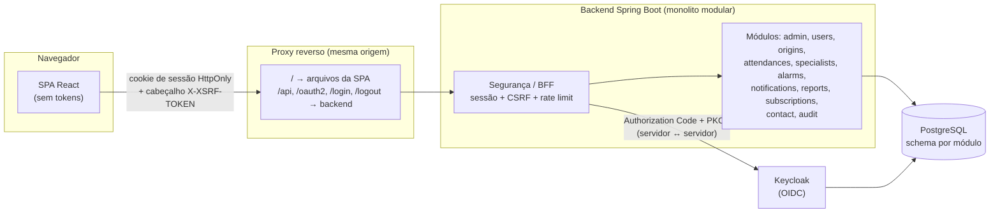
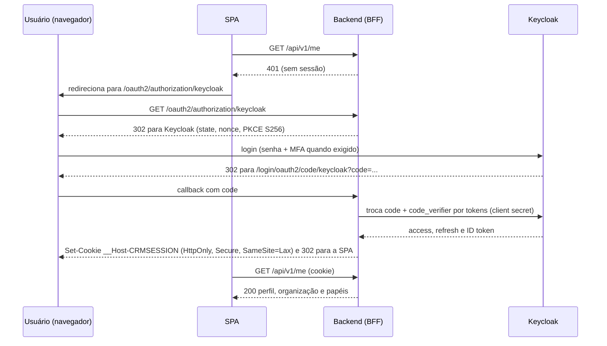
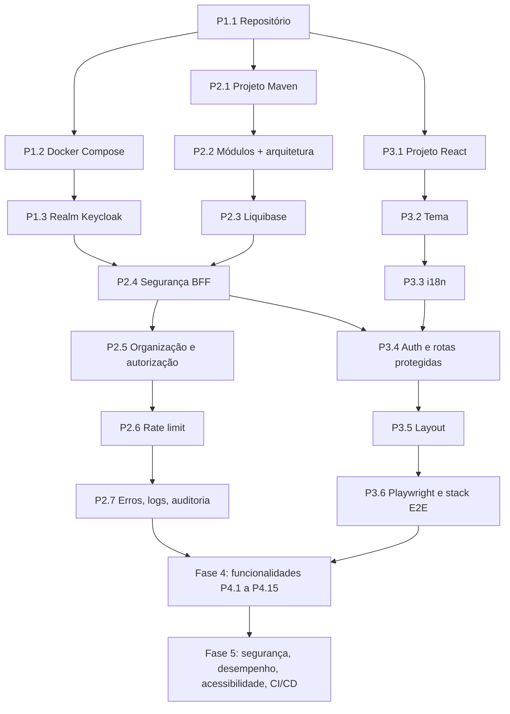

# aosoluti CRM — guia de implementação

Este documento descreve, passo a passo, como construir o sistema apresentado na landing page do aosoluti CRM: filas de atendimento em quadro, origens de atendimento personalizadas, personalização, alarmes, grupos de especialistas, visão do gestor e planos.

Ele foi escrito para ser executado por **agentes de IA**. Cada passo tem entradas, tarefas, entregáveis e critérios de aceite verificáveis por comando. A seção [Como os agentes devem usar este guia](#0-como-os-agentes-devem-usar-este-guia) vale para todos os passos.

## Sumário

0. [Como os agentes devem usar este guia](#0-como-os-agentes-devem-usar-este-guia)
1. [Premissas e stack](#1-premissas-e-stack)
2. [Arquitetura](#2-arquitetura)
3. [Estrutura do repositório](#3-estrutura-do-repositório)
4. [Requisitos funcionais](#4-requisitos-funcionais)
5. [Requisitos não funcionais](#5-requisitos-não-funcionais)
6. [Diretrizes de segurança](#6-diretrizes-de-segurança)
7. [Backend: monolito modular](#7-backend-monolito-modular)
8. [Frontend](#8-frontend)
9. [Modelo de dados](#9-modelo-de-dados)
10. [API](#10-api)
11. [Plano de execução](#11-plano-de-execução)
12. [Estratégia de testes](#12-estratégia-de-testes)
13. [Definição de pronto e rastreabilidade](#13-definição-de-pronto-e-rastreabilidade)
14. [Referências](#14-referências)

---

## 0. Como os agentes devem usar este guia

### 0.1 Regras gerais

1. **Siga a ordem dos passos.** Um passo só começa quando todos os passos listados em "Depende de" estão com os critérios de aceite passando na branch principal.
2. **Um passo por pull request.** O título do PR começa com o identificador do passo, por exemplo `P2.4 — Segurança do BFF`. A descrição lista os requisitos atendidos (RF/RNF) e os comandos de verificação executados, com a saída resumida.
3. **Critérios de aceite são obrigatórios.** Rode todos os comandos de verificação do passo e os testes já existentes antes de abrir o PR. Se algum falhar, corrija antes de abrir o PR.
4. **Nunca desative, pule ou apague testes** para deixar o build verde. Nunca use `@Disabled`, `test.skip`, `-DskipTests` ou equivalentes em código commitado.
5. **Nunca commite segredos.** Senhas, client secrets e chaves ficam em variáveis de ambiente. O repositório tem apenas arquivos `.env.example` com valores fictícios.
6. **Respeite as fronteiras dos módulos** (seção 7). Os testes de arquitetura (Spring Modulith + ArchUnit) precisam passar em todo PR.
7. **Sem integrações externas de mensageria.** O sistema **não** se conecta a WhatsApp, Instagram, telefonia ou qualquer plataforma de mensagens. As origens de atendimento são categorias cadastradas pelos usuários (RF-ORI). Não adicione SDKs, webhooks ou APIs dessas plataformas.
8. **Decisões ficam registradas.** Qualquer escolha que não esteja definida aqui (biblioteca, padrão, trade-off) vira um ADR curto em `docs/adr/NNNN-titulo.md` (contexto, decisão, consequências).
9. **Versões.** Onde este guia diz "última versão estável", consulte a fonte oficial no momento da execução e **fixe a versão exata** (sem `latest`, sem intervalos). Registre as versões escolhidas em `docs/versions.md`.
10. **Idioma.** Código, nomes de classes, tabelas e endpoints em inglês. Textos de interface nos três idiomas (pt-BR, en-US, es-ES). Documentação e ADRs em português.
11. **Dúvida de requisito.** Se um requisito estiver ambíguo, escolha a interpretação mais restritiva em segurança e privacidade, registre em ADR e siga.

### 0.2 Formato dos passos

Cada passo da seção 11 segue este formato:

| Campo | Conteúdo |
|---|---|
| **Objetivo** | O que o passo entrega, em uma frase. |
| **Depende de** | Passos que precisam estar concluídos. |
| **Requisitos** | IDs de RF/RNF atendidos. |
| **Tarefas** | Lista numerada do que fazer. |
| **Entregáveis** | Arquivos e artefatos que precisam existir ao final. |
| **Critérios de aceite** | Condições verificáveis, com os comandos que as comprovam. |

### 0.3 Comandos padrão de verificação

Estes comandos existem a partir do passo P1.1 e devem passar em todo PR:

```bash
# infraestrutura local
docker compose -f infra/docker-compose.yml up -d --wait

# backend (testes unitários, integração com Testcontainers, arquitetura, cobertura)
cd backend && ./mvnw -B verify

# frontend (lint, tipos, testes de unidade quando houver, build)
cd frontend && npm ci && npm run lint && npm run typecheck && npm run build

# ponta a ponta (sobe a stack completa e roda o Playwright)
cd frontend && npm run e2e
```

---

## 1. Premissas e stack

| Camada | Tecnologia | Observações |
|---|---|---|
| Identidade / SSO | **Keycloak** (última versão estável) | OIDC, Authorization Code + PKCE, MFA, detecção de força bruta, Organizations. |
| Backend | **Java 25**, **Spring Boot** (última versão estável compatível com Java 25) | Spring Web MVC, Spring Security (OAuth2 Client), Spring Data JPA, Spring Session JDBC, Spring Modulith, Bean Validation, Actuator. |
| Build | **Maven** (via Maven Wrapper `./mvnw`) | Projeto Maven único; os módulos de negócio são pacotes, não módulos Maven. |
| Banco | **PostgreSQL** (última versão estável) | Um schema por módulo de negócio. |
| Migrações | **Liquibase** | Changelogs por módulo, em YAML ou XML, versionados. |
| Testes backend | **JUnit 5+**, **Testcontainers**, **ArchUnit**, Spring Modulith test | Integração com PostgreSQL e Keycloak reais em containers. |
| Frontend | **React** + **Vite** + **TypeScript** + **Tailwind CSS** | React Router, TanStack Query, react-i18next, dnd-kit, React Hook Form + Zod. |
| Testes frontend | **Playwright** (ponta a ponta) | Inclui verificação de acessibilidade com axe. |
| Ambiente local | **Docker Compose** | PostgreSQL, Keycloak e Mailpit (e-mails de desenvolvimento). |

### 1.1 Premissas de produto

- **Multi-empresa (multi-tenant).** Cada empresa cliente é uma organização isolada. Nenhum dado de uma organização pode ser lido ou alterado por usuários de outra.
- **Sem captura automática de mensagens.** Os atendimentos e as interações são registrados pelos usuários. Os relógios de prazo (alarmes) se baseiam nesses registros.
- **Origens são categorias.** Web, WhatsApp, Instagram, telefone e outras são nomes cadastrados por cada organização, sem vínculo técnico com essas plataformas.
- **Planos definem limites.** Essencial, Profissional e Empresarial liberam recursos e limites diferentes (RF-PLA). Não há cobrança dentro do sistema nesta versão.

---

## 2. Arquitetura

O sistema usa o padrão **BFF (Backend for Frontend)**: o backend Spring faz o login com o Keycloak e guarda os tokens no servidor. O navegador recebe apenas um cookie de sessão `HttpOnly`. Os tokens OAuth **nunca** chegam ao JavaScript, ao `localStorage` ou à URL. Esse é o padrão recomendado pelo IETF para aplicações no navegador ("OAuth 2.0 for Browser-Based Applications").



### 2.1 Fluxo de login



### 2.2 Decisões de arquitetura

| Decisão | Motivo |
|---|---|
| BFF com sessão no servidor | Tokens não ficam expostos a XSS; logout e revogação centralizados; atende "não compartilhar token". |
| Mesma origem para SPA e API | Dispensa CORS; cookies `SameSite` e `__Host-` funcionam; CSP simples. |
| Monolito modular com Spring Modulith | Módulos independentes, verificados em teste, prontos para separação futura. |
| Schema de banco por módulo | Cada módulo é dono dos seus dados; facilita extrair um módulo para outro serviço. |
| Comunicação entre módulos por API pública e eventos | Evita acoplamento por tabelas e repositórios. |
| Spring Session JDBC | Sessões sobrevivem a reinícios e permitem mais de uma instância do backend. |
| SSE para tempo real | Simples, passa por proxies HTTP, autenticado pelo mesmo cookie. |

---

## 3. Estrutura do repositório

Repositório único (monorepo) com backend, frontend e infraestrutura:

```
crm/
├── backend/                    # Spring Boot (Maven)
│   ├── mvnw, .mvn/
│   ├── pom.xml
│   └── src/
│       ├── main/java/com/aosoluti/crm/...
│       ├── main/resources/
│       │   ├── application.yml
│       │   └── db/changelog/   # Liquibase (master + um diretório por módulo)
│       └── test/java/com/aosoluti/crm/...
├── frontend/                   # React + Vite + Tailwind
│   ├── package.json
│   ├── vite.config.ts
│   ├── playwright.config.ts
│   ├── e2e/                    # testes Playwright
│   └── src/...
├── infra/
│   ├── docker-compose.yml      # PostgreSQL, Keycloak, Mailpit
│   ├── docker-compose.e2e.yml  # stack completa para os testes ponta a ponta
│   ├── .env.example
│   ├── postgres/init/          # criação dos bancos e usuários
│   ├── keycloak/realm/         # realm versionado (JSON)
│   └── proxy/                  # configuração do proxy reverso (nginx)
├── docs/
│   ├── adr/
│   ├── versions.md
│   └── security/checklist.md
└── .github/workflows/          # CI
```

---

## 4. Requisitos funcionais

Prioridade: **M** = obrigatório nesta versão, **S** = desejável.

### 4.1 Autenticação e sessão (RF-AUT)

| ID | Requisito | Prior. |
|---|---|---|
| RF-AUT-01 | O usuário entra no sistema pelo Keycloak (SSO), com usuário e senha e, quando configurado, segundo fator (OTP ou WebAuthn). | M |
| RF-AUT-02 | Rotas da aplicação, exceto as públicas, exigem usuário autenticado. Sem sessão, o usuário é levado ao login e, depois, volta à página que tentou abrir. | M |
| RF-AUT-03 | O usuário sai do sistema pelo botão "Sair": a sessão local é encerrada e a sessão no Keycloak também (logout OIDC iniciado pelo cliente). | M |
| RF-AUT-04 | Se a sessão for encerrada no Keycloak (por um administrador ou por logout em outro cliente), a sessão no backend é invalidada (logout back-channel). | M |
| RF-AUT-05 | A sessão expira após 30 minutos sem uso e após 12 horas no total. A interface avisa quando a sessão expirou e leva ao login. | M |
| RF-AUT-06 | Administradores da organização são obrigados a usar segundo fator. | M |

### 4.2 Organização e administração (RF-ADM)

| ID | Requisito | Prior. |
|---|---|---|
| RF-ADM-01 | Cada usuário pertence a uma organização. Todos os dados da aplicação são isolados por organização. | M |
| RF-ADM-02 | O administrador da organização convida usuários por e-mail e define o papel: administrador, gestor ou atendente. | M |
| RF-ADM-03 | O administrador desativa e reativa usuários. Usuário desativado não entra no sistema e não recebe atendimentos. | M |
| RF-ADM-04 | O administrador edita os dados da organização (nome, fuso horário, idioma padrão). | M |
| RF-ADM-05 | Papéis e permissões: **administrador** configura tudo; **gestor** gerencia filas, grupos, alarmes e vê relatórios; **atendente** trabalha nos atendimentos das filas e grupos a que tem acesso. | M |

### 4.3 Usuários e preferências (RF-USR)

| ID | Requisito | Prior. |
|---|---|---|
| RF-USR-01 | O usuário vê o próprio perfil (nome, e-mail, papel, grupos). Nome e e-mail vêm do Keycloak. | M |
| RF-USR-02 | O usuário escolhe o tema (claro, escuro ou do sistema) e o idioma (pt-BR, en-US, es-ES). A escolha fica salva no perfil e vale em qualquer dispositivo. | M |
| RF-USR-03 | O usuário informa sua disponibilidade: disponível ou ausente. Usuário ausente não recebe novos atendimentos pela distribuição automática. | M |

### 4.4 Origens de atendimento (RF-ORI)

| ID | Requisito | Prior. |
|---|---|---|
| RF-ORI-01 | Administradores e gestores cadastram origens de atendimento com nome, cor e ordem de exibição. Exemplos: Web, WhatsApp, Instagram, Telefone, E-mail, Balcão. | M |
| RF-ORI-02 | Origens podem ser renomeadas, ter a cor alterada e ser desativadas ou reativadas. Não podem ser excluídas se já foram usadas em algum atendimento. | M |
| RF-ORI-03 | Ao abrir um atendimento, o usuário escolhe uma origem ativa. O cartão mostra o nome e a cor da origem como etiqueta de texto, sem ícones de plataformas. | M |
| RF-ORI-04 | Atendimentos antigos continuam mostrando origens desativadas. Origens desativadas não aparecem na escolha de novos atendimentos. | M |
| RF-ORI-05 | Nomes de origem são únicos na organização, sem diferenciar maiúsculas e minúsculas. | M |
| RF-ORI-06 | O sistema **não** se conecta a nenhuma plataforma representada pelas origens e não coleta dados delas. | M |
| RF-ORI-07 | Nova organização recebe as origens iniciais Web, WhatsApp, Instagram e Telefone, que podem ser editadas. | S |

### 4.5 Filas e quadro de atendimentos (RF-FIL)

| ID | Requisito | Prior. |
|---|---|---|
| RF-FIL-01 | Gestores criam, renomeiam, reordenam e arquivam filas de atendimento. | M |
| RF-FIL-02 | Cada fila tem etapas (colunas) com nome e ordem editáveis. Cada etapa tem um tipo: **aberta**, **aguardando cliente** ou **concluída**. Toda fila tem pelo menos uma etapa aberta e uma concluída. | M |
| RF-FIL-03 | Nova fila recebe as etapas padrão: Novos (aberta), Em atendimento (aberta), Aguardando cliente (aguardando cliente), Resolvidos (concluída). | M |
| RF-FIL-04 | O quadro mostra as etapas de uma fila como colunas, com a contagem de cartões em cada uma. A coluna concluída mostra apenas os cartões resolvidos no dia (no fuso da organização), com a contagem do dia. | M |
| RF-FIL-05 | O usuário move cartões entre etapas arrastando com mouse, toque ou teclado. A mudança aparece para os outros usuários do quadro em até 3 segundos. | M |
| RF-FIL-06 | Se dois usuários alterarem o mesmo cartão ao mesmo tempo, a segunda gravação é recusada com aviso e o cartão é recarregado (controle de concorrência otimista). | M |
| RF-FIL-07 | O quadro pode ser filtrado por origem, grupo, responsável, etiqueta e texto. | M |

### 4.6 Atendimentos (cartões) (RF-ATD)

| ID | Requisito | Prior. |
|---|---|---|
| RF-ATD-01 | O usuário abre um atendimento com: título, fila, origem, dados do contato (nome, e-mail, telefone, texto livre), descrição, grupo de especialistas (opcional), etiquetas e campos personalizados. | M |
| RF-ATD-02 | O cartão mostra: origem, título, responsável, grupo, etiquetas e o tempo desde o último registro do cliente sem resposta. | M |
| RF-ATD-03 | O usuário registra interações no atendimento: **mensagem do cliente**, **resposta ao cliente**, **ligação** e **nota interna**. Cada registro tem autor, data e texto. | M |
| RF-ATD-04 | O atendimento guarda o histórico de alterações: criação, mudança de etapa, responsável, grupo, origem, etiquetas, campos e transferências, com autor e data. | M |
| RF-ATD-05 | O usuário assume um atendimento ou o atribui a outro usuário com acesso à fila. | M |
| RF-ATD-06 | Mover um cartão para uma etapa concluída marca o atendimento como resolvido e registra a data. Voltar para uma etapa aberta reabre o atendimento. | M |
| RF-ATD-07 | O usuário anexa arquivos ao atendimento (até 10 MB por arquivo, tipos permitidos: PDF, imagens PNG/JPEG/WebP, TXT, CSV, DOCX, XLSX). | S |
| RF-ATD-08 | O usuário busca atendimentos por título, contato e texto das interações, dentro das filas a que tem acesso. | M |

### 4.7 Personalização (RF-PER)

| ID | Requisito | Prior. |
|---|---|---|
| RF-PER-01 | O administrador cria campos personalizados para os atendimentos, dos tipos texto, número, data, lista de opções e sim/não, com indicação de obrigatório. | M |
| RF-PER-02 | O administrador cria etiquetas com nome e cor. | M |
| RF-PER-03 | Administradores e gestores cadastram respostas rápidas (título e texto). O atendente insere uma resposta rápida ao registrar uma interação. | M |
| RF-PER-04 | Etapas das filas usam os nomes que a organização definir (RF-FIL-02). | M |
| RF-PER-05 | Tema e idioma são escolhidos por usuário (RF-USR-02). | M |

### 4.8 Alarmes e lembretes (RF-ALM)

| ID | Requisito | Prior. |
|---|---|---|
| RF-ALM-01 | Gestores criam regras de prazo por fila ou por grupo. Tipos de regra: **sem resposta** (tempo desde o último registro de mensagem do cliente sem resposta) e **cliente sem retorno** (tempo em etapa "aguardando cliente" sem novo registro do cliente). | M |
| RF-ALM-02 | Cada regra define o limite de tempo e as ações: avisar o responsável, avisar os líderes do grupo e, para "cliente sem retorno", mover o cartão para uma etapa escolhida. | M |
| RF-ALM-03 | Quando uma regra dispara, o cartão fica destacado no quadro e as pessoas indicadas recebem uma notificação na aplicação. O disparo acontece em até 1 minuto após o limite. | M |
| RF-ALM-04 | Uma regra dispara uma única vez por atendimento até que a condição deixe de valer (por exemplo, uma resposta é registrada). | M |
| RF-ALM-05 | O atendente agenda lembretes em um atendimento (data, hora e texto). No horário, ele recebe uma notificação. | M |
| RF-ALM-06 | As notificações podem também ser enviadas por e-mail, conforme a preferência do usuário. | S |

### 4.9 Grupos de especialistas (RF-GRP)

| ID | Requisito | Prior. |
|---|---|---|
| RF-GRP-01 | Gestores criam grupos de especialistas por assunto (ex.: Financeiro, Suporte técnico, Comercial), com nome e descrição. | M |
| RF-GRP-02 | Um usuário pode participar de vários grupos. Cada grupo pode ter um ou mais líderes. | M |
| RF-GRP-03 | Cada grupo define a regra de distribuição: **rodízio** ou **menor carga** (menos atendimentos abertos). | M |
| RF-GRP-04 | Atendimento criado com grupo e sem responsável é atribuído automaticamente a um membro disponível, conforme a regra do grupo. Sem membros disponíveis, fica na fila sem responsável e dispara aviso aos líderes. | M |
| RF-GRP-05 | O usuário transfere o atendimento para outro grupo com um motivo. O histórico e as interações são mantidos, e o novo grupo aplica sua regra de distribuição. | M |
| RF-GRP-06 | Cada grupo mostra: atendimentos na fila, membros disponíveis sobre o total, regra de distribuição e tempo médio da primeira resposta. | M |

### 4.10 Visão do gestor (RF-REL)

| ID | Requisito | Prior. |
|---|---|---|
| RF-REL-01 | Gestores veem um painel com, por grupo e por fila: atendimentos abertos, sem responsável, com alarme ativo, resolvidos no dia e tempo médio da primeira resposta. | M |
| RF-REL-02 | O painel atualiza em tempo real (até 5 segundos). | M |
| RF-REL-03 | O painel filtra por período (hoje, 7 dias, 30 dias) e mostra atendimentos por origem. | S |

### 4.11 Planos e limites (RF-PLA)

| ID | Requisito | Prior. |
|---|---|---|
| RF-PLA-01 | Cada organização tem um plano: **Essencial**, **Profissional** ou **Empresarial**. | M |
| RF-PLA-02 | Limites por plano: Essencial até 5 usuários e 3 filas; Profissional até 50 usuários e filas ilimitadas; Empresarial sem limites. | M |
| RF-PLA-03 | Recursos por plano: grupos de especialistas, distribuição automática, alarmes por grupo, campos personalizados, etiquetas e respostas rápidas a partir do Profissional; visão do gestor apenas no Empresarial. | M |
| RF-PLA-04 | Ao atingir um limite ou tentar usar um recurso fora do plano, o sistema recusa a ação e explica o motivo e o plano necessário. | M |
| RF-PLA-05 | A troca de plano é feita por um operador da aosoluti (fora da aplicação do cliente) e vale imediatamente. | M |

### 4.12 Contato público e privacidade (RF-PRV)

| ID | Requisito | Prior. |
|---|---|---|
| RF-PRV-01 | O formulário de contato da landing page envia nome, e-mail, telefone, empresa, assunto, mensagem e aceite da Política de Privacidade para um endpoint público. | M |
| RF-PRV-02 | O endpoint de contato valida os dados, recusa envios sem aceite, aplica limite de envios por IP e descarta envios de robôs (campo isca). A mensagem é gravada e enviada por e-mail à equipe. | M |
| RF-PRV-03 | O administrador exporta os dados da organização (atendimentos, interações, cadastros) em JSON. | M |
| RF-PRV-04 | O administrador anonimiza os dados de contato de um cliente atendido, a pedido do titular (LGPD). As interações são mantidas sem os dados pessoais. | M |
| RF-PRV-05 | Ações sensíveis (login, logout, mudança de papel, exportação, anonimização, mudança de plano) ficam em trilha de auditoria consultável pelo administrador. | M |
| RF-PRV-06 | A aplicação não usa cookies de publicidade nem de rastreamento. Usa apenas o cookie de sessão e o cookie de proteção CSRF, estritamente necessários. | M |

### 4.13 Interface (RF-UI)

| ID | Requisito | Prior. |
|---|---|---|
| RF-UI-01 | Troca de tema claro/escuro/sistema, com as cores da marca (seção 8.4). | M |
| RF-UI-02 | Interface em pt-BR (padrão), en-US e es-ES, com troca a qualquer momento. Antes do login, o idioma segue o navegador; depois, o perfil. | M |
| RF-UI-03 | Layout responsivo de 320 px a telas grandes. Abaixo de 960 px, a navegação vira menu. | M |
| RF-UI-04 | Rotas protegidas por autenticação e por papel. Usuário sem permissão vê uma página "Sem acesso". | M |

---

## 5. Requisitos não funcionais

| ID | Categoria | Requisito | Como verificar |
|---|---|---|---|
| RNF-SEG-01 | Segurança | Atender o OWASP ASVS 5.0 nível 2 nos itens aplicáveis. | Checklist em `docs/security/checklist.md` preenchido no passo P5.1. |
| RNF-SEG-02 | Segurança | Tokens OAuth ficam apenas no servidor (BFF). Nenhum token em `localStorage`, `sessionStorage`, cookies legíveis por JS, URLs ou logs. | Teste de integração e teste E2E que inspeciona storage e cookies. |
| RNF-SEG-03 | Segurança | Cookie de sessão `__Host-CRMSESSION`: `Secure`, `HttpOnly`, `SameSite=Lax`, `Path=/`, sem `Domain`. | Teste de integração nos cabeçalhos `Set-Cookie`. |
| RNF-SEG-04 | Segurança | Proteção CSRF em toda requisição que altera estado (POST, PUT, PATCH, DELETE), inclusive logout. | Teste: requisição sem token recebe 403. |
| RNF-SEG-05 | Segurança | Rate limit: 300 requisições/min por usuário na API; 20/min por IP no início do login; 5/hora por IP no formulário de contato. Excesso retorna 429 com `Retry-After`. | Teste de integração. |
| RNF-SEG-06 | Segurança | Cabeçalhos: CSP restritiva, HSTS (produção), `X-Content-Type-Options: nosniff`, `Referrer-Policy`, `Permissions-Policy`, `frame-ancestors 'none'`, `Cross-Origin-Opener-Policy`. | Teste de integração e E2E. |
| RNF-SEG-07 | Segurança | Autorização em todas as rotas por papel **e** por organização. Identificadores vindos do cliente nunca definem a organização. | Testes de acesso cruzado entre organizações (IDOR). |
| RNF-SEG-08 | Segurança | Keycloak: PKCE S256 obrigatório, redirect URIs exatos, sem implicit e sem password grant, detecção de força bruta, política de senha, access token de 5 minutos, rotação de refresh token. | Exportação do realm revisada e teste de login. |
| RNF-SEG-09 | Segurança | Segredos apenas por variáveis de ambiente ou secrets do orquestrador. Varredura de segredos no CI. | Job de CI com gitleaks. |
| RNF-SEG-10 | Segurança | Dependências sem vulnerabilidades altas ou críticas conhecidas; SBOM gerado a cada build. | OWASP Dependency-Check, `npm audit`, CycloneDX no CI. |
| RNF-SEG-11 | Segurança | Erros não expõem stack trace, SQL ou versões. Respostas de erro no formato Problem Details (RFC 9457). | Teste de integração. |
| RNF-SEG-12 | Segurança | Logs sem dados pessoais sensíveis, tokens ou senhas. Eventos de segurança registrados com ID de correlação. | Teste com captura de log. |
| RNF-PRV-01 | Privacidade | Conformidade com a LGPD: minimização de dados, finalidade, exportação e anonimização (RF-PRV). | Revisão no passo P5.1. |
| RNF-PRV-02 | Privacidade | Fontes e recursos servidos pela própria aplicação, sem CDNs de terceiros que recebam o IP do usuário. | CSP `default-src 'self'`. |
| RNF-DES-01 | Desempenho | Carregar um quadro com até 500 cartões em p95 < 500 ms no backend; demais endpoints de leitura p95 < 300 ms. | Teste de carga (k6) no passo P5.2. |
| RNF-DES-02 | Desempenho | Frontend: LCP < 2,5 s em 4G simulado na página do quadro; bundle inicial < 250 KB gzip. | Lighthouse CI e relatório do Vite. |
| RNF-DIS-01 | Disponibilidade | Backend sem estado em memória que impeça mais de uma instância (sessão em banco, jobs com trava distribuída). | Teste com duas instâncias no compose de E2E (P5.2). |
| RNF-DIS-02 | Disponibilidade | Health checks de liveness e readiness. | `GET /actuator/health/liveness` e `/readiness`. |
| RNF-OBS-01 | Observabilidade | Logs estruturados em JSON, métricas Micrometer (Prometheus) e rastreamento OpenTelemetry. | Endpoints do Actuator e logs no formato definido. |
| RNF-ARQ-01 | Arquitetura | Módulos independentes, verificados por Spring Modulith e ArchUnit em todo build. | `./mvnw verify`. |
| RNF-ARQ-02 | Arquitetura | Cada módulo é dono do seu schema; nenhuma consulta ou chave estrangeira cruza schemas. | Teste ArchUnit + revisão dos changelogs. |
| RNF-QUA-01 | Qualidade | Cobertura de linhas ≥ 80% nas camadas de domínio e aplicação do backend. | JaCoCo com `check` no `verify`. |
| RNF-QUA-02 | Qualidade | Formatação e lint automáticos: Spotless (Java), ESLint + Prettier (TS). | CI. |
| RNF-ACE-01 | Acessibilidade | WCAG 2.2 nível AA: contraste, navegação por teclado (inclusive arrastar cartões), foco visível, rótulos. | axe no Playwright sem violações sérias ou críticas. |
| RNF-RES-01 | Responsividade | Sem rolagem horizontal da página de 320 px a 1440 px. | Teste Playwright em várias larguras. |
| RNF-I18N-01 | Internacionalização | Nenhum texto de interface fixo no código; datas, números e horas formatados pelo idioma e fuso. | Lint de i18n e teste E2E trocando idioma. |
| RNF-OPS-01 | Operação | `docker compose up` sobe o ambiente local completo em um comando; migrações aplicadas na subida. | Passo P1.2. |
| RNF-OPS-02 | Operação | Imagens de container com usuário não root, sistema de arquivos somente leitura quando possível e versão fixa. | Revisão dos Dockerfiles e do compose. |
| RNF-OPS-03 | Operação | Backup diário do PostgreSQL com retenção de 30 dias e teste de restauração documentado (produção). | Runbook em `docs/runbooks/backup.md`. |

---

## 6. Diretrizes de segurança

Referências principais: OWASP ASVS 5.0, OWASP Top 10, OWASP Cheat Sheet Series, RFC 9700 (OAuth 2.0 Security Best Current Practice), IETF OAuth 2.0 for Browser-Based Applications, NIST SP 800-63B, LGPD e o guia de segurança da ANPD, e as recomendações do CERT.br.

### 6.1 Autenticação e tokens

- Login apenas pelo Keycloak via OIDC **Authorization Code + PKCE (S256)**, com client **confidencial** (`crm-bff`) e segredo lido de variável de ambiente.
- O backend guarda os tokens na sessão do servidor (`OAuth2AuthorizedClientService` com persistência JDBC). **Tokens não são enviados ao navegador**, não são logados e não são compartilhados entre usuários, sessões ou serviços.
- Cada serviço que precisar chamar o Keycloak (por exemplo, a Admin API para convites) usa **client próprio** com o mínimo de permissões (`crm-admin-api`, client credentials, papéis `manage-users` e `view-users` restritos ao realm), nunca o token do usuário.
- Access token com 5 minutos; refresh token com rotação e revogação ao reutilizar (`Revoke Refresh Token` ligado).
- Logout OIDC iniciado pelo cliente (RP-initiated) e logout back-channel habilitados.
- MFA obrigatório para o papel administrador (fluxo condicional no Keycloak). OTP e WebAuthn disponíveis para todos.
- Política de senha alinhada ao NIST SP 800-63B: mínimo de 12 caracteres, diferente do usuário e do e-mail, histórico das 5 últimas. Evite regras de composição arbitrárias.
- Detecção de força bruta do Keycloak ligada (bloqueio temporário progressivo).

### 6.2 Sessão e cookies

| Cookie | Atributos | Conteúdo |
|---|---|---|
| `__Host-CRMSESSION` | `Secure; HttpOnly; SameSite=Lax; Path=/` | ID opaco da sessão (Spring Session JDBC). |
| `__Host-XSRF-TOKEN` | `Secure; SameSite=Lax; Path=/` (legível por JS, por desenho do padrão double submit) | Token CSRF. Não é credencial. |

- `SameSite=Lax` no cookie de sessão é necessário para o retorno do login (redirecionamento de topo vindo do Keycloak). A proteção de escrita vem do token CSRF.
- Proteção contra fixação de sessão: novo ID após o login (padrão do Spring Security).
- Tempo ocioso de 30 minutos e tempo absoluto de 12 horas (RF-AUT-05).
- Em desenvolvimento, use sempre `http://localhost` (Vite em `localhost:5173`, stack E2E em `localhost:8088`). Os navegadores tratam `localhost` como contexto seguro, então `Secure` e o prefixo `__Host-` funcionam sem HTTPS. Não relaxe esses atributos em nenhum perfil. Qualquer outro host exige HTTPS.

### 6.3 CSRF

- Spring Security com `CookieCsrfTokenRepository` (cookie legível pelo JS) e o tratamento de token para SPA com proteção contra BREACH, conforme a documentação do Spring Security para SPAs (nas versões que oferecem, `csrf.spa()`).
- A SPA lê o cookie e envia o valor no cabeçalho `X-XSRF-TOKEN` em POST, PUT, PATCH e DELETE.
- Nenhuma operação que altera estado usa GET.
- O endpoint público de contato também exige CSRF: a landing obtém o token em `GET /api/v1/public/csrf` antes do envio. Se a landing estiver em outro domínio, use um token de formulário assinado de curta duração e registre a decisão em ADR.

### 6.4 Rate limit e abuso

- Filtro com **Bucket4j**. Com mais de uma instância, os buckets ficam no PostgreSQL (`bucket4j-postgresql`); com uma instância, em memória (Caffeine).
- Chaves: usuário autenticado (sub + organização) para a API; IP (considerando `X-Forwarded-For` apenas do proxy confiável) para rotas públicas e início de login.
- Limites em RNF-SEG-05. Resposta `429 Too Many Requests` com `Retry-After` e corpo Problem Details.
- Na borda de produção, o proxy reverso aplica limite de conexões e de requisições por IP como segunda camada.
- Formulário de contato: campo isca oculto, tempo mínimo de preenchimento (3 s) e limite de tamanho dos campos.

### 6.5 Cabeçalhos HTTP

```
Content-Security-Policy: default-src 'self'; script-src 'self'; style-src 'self'; img-src 'self' data:;
  font-src 'self'; connect-src 'self'; frame-ancestors 'none'; base-uri 'none';
  form-action 'self' https://<host-do-keycloak>; object-src 'none'
Strict-Transport-Security: max-age=31536000; includeSubDomains   (somente produção, com HTTPS)
X-Content-Type-Options: nosniff
Referrer-Policy: strict-origin-when-cross-origin
Permissions-Policy: camera=(), microphone=(), geolocation=(), payment=()
Cross-Origin-Opener-Policy: same-origin
Cross-Origin-Resource-Policy: same-origin
```

- CORS desligado (SPA e API na mesma origem). Se algum dia for necessário, use lista explícita de origens.
- O Vite deve gerar build sem `eval` e sem estilos inline que exijam `'unsafe-inline'`.

### 6.6 Autorização e isolamento entre organizações

- Autorização por papel com `@PreAuthorize` nos serviços de aplicação e por organização em **toda** consulta.
- O `tenantId` vem da sessão do usuário (organização resolvida no login), nunca de parâmetros, corpo ou cabeçalhos da requisição.
- Toda tabela de negócio tem `tenant_id`. Os repositórios filtram por `tenant_id` (filtro do Hibernate habilitado por requisição **e** condição explícita nas consultas críticas).
- Buscar por ID de outra organização retorna 404 (não 403), para não revelar a existência do recurso.
- Testes automatizados de acesso cruzado para cada endpoint (P2.5 e cada passo de módulo).

### 6.7 Entrada, saída e arquivos

- Bean Validation em todos os DTOs de entrada: tamanhos máximos, formatos e listas permitidas.
- Tamanho máximo do corpo da requisição: 1 MB (JSON) e 10 MB (upload).
- Consultas apenas com JPA/parâmetros; nenhuma concatenação de SQL.
- React escapa a saída por padrão. É proibido `dangerouslySetInnerHTML`. Textos com quebra de linha são exibidos com CSS (`white-space: pre-wrap`).
- Uploads: verificação do tipo real pelo conteúdo (magic bytes), lista de tipos permitidos, nome gerado pelo servidor, download com `Content-Disposition: attachment` e `X-Content-Type-Options: nosniff`. Armazenamento fora da pasta pública.

### 6.8 Dados, logs e segredos

- Usuários de banco separados: `crm_migrator` (DDL, usado só pelo Liquibase) e `crm_app` (DML nos schemas da aplicação). Keycloak usa banco e usuário próprios.
- Conexão com o banco por TLS em produção; criptografia em repouso fornecida pela infraestrutura.
- Logs em JSON com ID de correlação, sem corpo de requisição, sem cabeçalhos `Cookie`/`Authorization` e sem dados pessoais. E-mails, quando necessários para diagnóstico, são mascarados.
- Trilha de auditoria (RF-PRV-05) em tabela própria, somente inserção.
- `.env.example` com valores fictícios; `.env` no `.gitignore`; gitleaks no CI.

### 6.9 Cadeia de suprimentos e containers

- Versões fixas de dependências, lockfiles versionados (`package-lock.json`) e Maven Wrapper com checksum.
- Dependabot ou Renovate para atualizações; OWASP Dependency-Check e `npm audit --audit-level=high` no CI; SBOM CycloneDX para backend e frontend.
- Imagens com usuário não root, `read_only: true` quando possível, `no-new-privileges`, sem portas administrativas expostas publicamente (console admin do Keycloak restrito à rede interna em produção).

---

## 7. Backend: monolito modular

### 7.1 Módulos

Pacote base: `com.aosoluti.crm`. Cada módulo é um pacote direto abaixo do base e é detectado pelo Spring Modulith.

| Módulo | Responsabilidade | Schema | Depende de |
|---|---|---|---|
| `shared` | Núcleo compartilhado mínimo: `TenantId`, `UserId`, interface `CurrentTenant`, tipos de erro, `Clock`, paginação, interface `ExportContributor`. Sem regras de negócio e sem persistência. | — | — |
| `config` | Segurança (BFF, sessão, CSRF, cabeçalhos), rate limit, implementação de `CurrentTenant`, tratamento de erros, OpenAPI, Jackson, agendamento. | `platform` (sessões, travas, buckets, registro de eventos) | `users`, `admin`, `audit` |
| `admin` | Organizações, membros (vínculo usuário-organização, papel, status), convites, configurações, campos personalizados, etiquetas, respostas rápidas. | `admin` | `subscriptions` |
| `users` | Perfil do usuário (espelho do Keycloak), preferências (tema, idioma, e-mail), disponibilidade. | `users` | `admin::api` (eventos) |
| `origins` | Cadastro de origens de atendimento. | `origins` | `admin::api` (eventos) |
| `attendances` | Filas, etapas, atendimentos, interações, histórico, anexos, busca, transferências. Define a SPI `GroupLookup`. | `attendances` | `origins`, `admin`, `subscriptions` |
| `specialists` | Grupos, membros, líderes, regra e estado da distribuição. Implementa `GroupLookup`. | `specialists` | `attendances`, `users`, `notifications`, `subscriptions` |
| `alarms` | Regras de prazo, avaliação agendada, ocorrências, lembretes. | `alarms` | `attendances`, `specialists`, `notifications`, `subscriptions` |
| `notifications` | Notificações na aplicação, e-mail e fluxo SSE. | `notifications` | `users`, `attendances::api` (eventos) |
| `reports` | Indicadores da visão do gestor e dos grupos (modelo de leitura alimentado por eventos). | `reports` | `attendances::api`, `specialists::api`, `alarms::api`, `users::api` (eventos), `notifications`, `subscriptions` |
| `subscriptions` | Planos, limites e recursos liberados por organização. | `subscriptions` | — |
| `contact` | Recebimento do formulário público de contato. | `contact` | `notifications` |
| `audit` | Trilha de auditoria. | `audit` | `admin::api`, `subscriptions::api`, `attendances::api` (eventos) |

Todos os módulos podem usar `shared`. A notação `modulo::api` indica dependência apenas do pacote `api` do outro módulo (tipos de evento e DTOs).

Regras:

- **Ouvir um evento de outro módulo conta como dependência** do `api` desse módulo. O grafo de dependências (chamadas e eventos) não pode ter ciclos; o Spring Modulith verifica isso em todo build.
- O sentido das dependências é o da tabela. Quando um módulo "de baixo" precisa de algo de um módulo "de cima", use **inversão de dependência**: o módulo de baixo declara uma interface (SPI) no seu `api` e o módulo de cima a implementa. Exemplo: `attendances` declara `GroupLookup` (existe o grupo? qual o nome?) e `specialists` fornece a implementação.
- `reports` e `audit` apenas reagem a eventos; nenhum módulo depende deles.
- Nunca acessar repositório ou tabela de outro módulo.

### 7.2 Estrutura interna de um módulo

```
com.aosoluti.crm.attendances
├── AttendancesApi.java              # interface pública (consultas e comandos usados por outros módulos)
├── api/                             # @NamedInterface("api"): DTOs e eventos publicados
│   ├── AttendanceCreated.java
│   ├── AttendanceMoved.java
│   └── AttendanceSummary.java
├── package-info.java                # @ApplicationModule(allowedDependencies = {...})
└── internal/
    ├── domain/                      # entidades, value objects, regras (sem Spring Web)
    ├── application/                 # casos de uso (@Service, @Transactional, @PreAuthorize)
    ├── infrastructure/
    │   └── persistence/             # repositórios Spring Data, entidades JPA, mapeamentos
    └── web/                         # controllers REST, DTOs de requisição/resposta, validação
```

- Tudo fora do pacote raiz do módulo e de `api/` é interno. O Spring Modulith falha o build se outro módulo usar classes de `internal`.
- Controllers ficam em `internal.web` e só chamam `internal.application`.
- Entidades JPA não saem do módulo. A interface pública expõe DTOs imutáveis (`record`).

### 7.3 Comunicação entre módulos

- **Síncrona:** chamada à interface pública (`OriginsApi.findActive(tenantId)`), na mesma transação apenas para leitura.
- **Assíncrona:** eventos de domínio publicados com `ApplicationEventPublisher` e consumidos com `@ApplicationModuleListener` (transacional, após o commit). O registro de publicação de eventos do Spring Modulith (JDBC, schema `platform`) garante reentrega se o consumidor falhar.
- Eventos são `record` em `api/`, com `tenantId`, IDs e os dados mínimos. Sem entidades dentro de eventos.

Eventos principais:

| Evento | Publicado por | Consumido por |
|---|---|---|
| `OrganizationCreated` | admin | users, origins (origens iniciais), attendances (fila inicial), audit. O plano inicial é definido por chamada de `admin` a `SubscriptionsApi`. |
| `MemberInvited`, `MemberRoleChanged`, `MemberDeactivated` | admin | users, audit |
| `UserAvailabilityChanged`, `UserDeactivated` | users | specialists, reports |
| `OriginChanged` | origins | attendances (cópia local de nome e cor) |
| `AttendanceCreated`, `AttendanceMoved`, `AttendanceAssigned`, `AttendanceResolved`, `AttendanceReopened` | attendances | specialists, alarms, notifications, reports, audit |
| `InteractionRegistered` | attendances | alarms, reports |
| `AttendanceTransferred` | attendances | specialists, reports, audit |
| `AssignmentRequested` | attendances | specialists (decide o responsável e chama `AttendancesApi.assign`) |
| `AlarmTriggered`, `AlarmCleared` | alarms | reports. As ações do alarme são chamadas diretas de `alarms` a `AttendancesApi` e `NotificationsApi`. |
| `PlanChanged` | subscriptions | audit. `admin` consulta o plano sob demanda via `SubscriptionsApi`. |

Chamadas diretas que substituem eventos para manter o grafo sem ciclos: `attendances` → `OriginsApi.markUsed(originId)` ao usar uma origem; `alarms` → `AttendancesApi.markAlarm/moveToStage`, `NotificationsApi.notify` e `SpecialistsApi.leadersOf`; `contact` → `NotificationsApi.sendTeamEmail`; `reports` → `NotificationsApi.publish("dashboard.updated")`.

### 7.4 Banco de dados e Liquibase

- Um schema por módulo (tabela 7.1). O Liquibase roda com o usuário `crm_migrator`; a aplicação conecta com `crm_app`.
- Estrutura:

```
src/main/resources/db/changelog/
├── db.changelog-master.yaml        # inclui os masters de cada módulo, em ordem
├── platform/  db.changelog.yaml + changes/0001-spring-session.yaml ...
├── admin/     db.changelog.yaml + changes/0001-organizations.yaml ...
├── users/     ...
└── attendances/ ...
```

- Cada changeset tem `id` no formato `<modulo>-<NNNN>-<descricao>`, `author: crm`, e `rollback` quando a mudança não for reversível automaticamente.
- Changesets nunca são editados depois de mesclados. Correções entram como novos changesets.
- Chaves primárias `uuid` geradas pela aplicação (UUID v7). Datas `timestamptz`. Colunas de auditoria `created_at`, `created_by`, `updated_at`, `updated_by`, e `version bigint` para controle otimista.
- **Proibido**: chave estrangeira ou `JOIN` entre schemas. Referências a outros módulos são colunas `uuid` sem FK.

### 7.5 Dependências Maven principais

`spring-boot-starter-web`, `spring-boot-starter-security`, `spring-boot-starter-oauth2-client`, `spring-boot-starter-data-jpa`, `spring-boot-starter-validation`, `spring-boot-starter-actuator`, `spring-boot-starter-mail`, `spring-session-jdbc`, `spring-modulith-starter-core`, `spring-modulith-starter-jpa`, `spring-modulith-events-jdbc`, `liquibase-core`, `postgresql`, `bucket4j` (core + postgresql), `shedlock-spring` + `shedlock-provider-jdbc-template`, `springdoc-openapi-starter-webmvc-ui`, `micrometer-registry-prometheus`, OpenTelemetry (starter do Spring Boot), `logstash-logback-encoder` (ou o log estruturado nativo do Spring Boot).

Testes: `spring-boot-starter-test` (JUnit 5+), `spring-security-test`, `spring-modulith-starter-test`, `testcontainers` (junit-jupiter, postgresql), `testcontainers-keycloak` (dasniko), `archunit-junit5`, `rest-assured` (opcional).

Plugins: `maven-compiler-plugin` (release 25), `maven-surefire-plugin` (unitários), `maven-failsafe-plugin` (integração, `*IT.java`), `jacoco-maven-plugin` (com `check`), `spotless-maven-plugin`, `cyclonedx-maven-plugin`, `dependency-check-maven`.

---

## 8. Frontend

### 8.1 Estrutura de pastas

```
frontend/src/
├── app/                 # App.tsx, providers (Query, Theme, I18n, Auth), tratamento global de erros
├── assets/              # fontes (Space Grotesk, Figtree) auto-hospedadas, ilustrações SVG, logo
├── components/
│   ├── ui/              # Button, Input, Select, Dialog, Menu, Switch, Toast, Badge, Tooltip
│   ├── layout/          # AppShell, Header, Nav, MobileMenu, PageHeader
│   ├── board/           # Board, Column, Card, CardDialog (quadro de atendimentos)
│   └── feedback/        # EmptyState, ErrorState, Loading, SessionExpired
├── config/              # leitura de variáveis VITE_*, constantes
├── context/             # ThemeContext, AuthContext, TenantContext
├── hooks/               # useAuth, useTheme, usePermission, useEventStream, useDebounce
├── i18n/
│   ├── index.ts         # configuração do i18next
│   └── locales/
│       ├── pt-BR/       # common.json, board.json, settings.json, ...
│       ├── en-US/
│       └── es-ES/
├── pages/
│   ├── public/          # NotFound, Forbidden, SignedOut
│   ├── dashboard/       # visão do gestor
│   ├── board/           # quadro da fila
│   ├── attendances/     # detalhe e busca
│   ├── groups/          # grupos de especialistas
│   ├── settings/        # organização, usuários, origens, filas, campos, etiquetas, respostas, alarmes
│   └── profile/         # perfil e preferências
├── routes/              # router.tsx, ProtectedRoute.tsx, RoleRoute.tsx, rotas por área
├── services/
│   ├── http.ts          # cliente fetch: credenciais, CSRF, Problem Details, 401/403/429
│   └── api/             # um arquivo por módulo do backend: origins.ts, attendances.ts, ...
├── types/               # tipos compartilhados gerados do OpenAPI (openapi-typescript)
├── utils/               # formatação de datas/números por idioma, cores, helpers
└── styles/              # index.css com Tailwind e tokens de tema
```

### 8.2 Autenticação e rotas protegidas

- `AuthContext` chama `GET /api/v1/me` ao iniciar. Resposta 200 → usuário autenticado (perfil, organização, papéis, plano e recursos); 401 → não autenticado.
- `ProtectedRoute` envolve todas as rotas da aplicação. Sem sessão, grava a rota desejada em `sessionStorage` (apenas o caminho, sem dados sensíveis) e faz `window.location.assign('/oauth2/authorization/keycloak')`. Depois do login, a SPA volta para o caminho gravado.
- `RoleRoute` verifica papel e recurso do plano; sem permissão, mostra `Forbidden`.
- Logout: formulário real `<form method="post" action="/logout">` com o campo oculto `_csrf`. Por ser uma navegação (e não `fetch`), o navegador segue o redirecionamento para o logout do Keycloak e volta à aplicação.
- `http.ts` trata 401 (sessão expirada → tela `SessionExpired` com botão para entrar), 403, 404, 409 (conflito de versão), 422 (validação por campo) e 429 (mensagem com tempo de espera).
- O frontend **não** usa bibliotecas OIDC no navegador (keycloak-js, oidc-client) e não manipula tokens.

### 8.3 Tempo real

- `useEventStream` abre `EventSource('/api/v1/stream')` (mesma origem, cookie de sessão).
- Eventos: `board.changed`, `notification.created`, `alarm.triggered`, `dashboard.updated`. Ao receber, invalida as consultas do TanStack Query afetadas.
- Reconexão automática com espera crescente; ao reconectar, recarrega os dados visíveis.

### 8.4 Tema

- Tailwind CSS com tokens em variáveis CSS, as mesmas cores da landing page (artefato "aosoluti CRM Logo"):

| Token | Claro | Escuro |
|---|---|---|
| `--bg` | `#f0f7f4` | `#2c3730` |
| `--bg-alt` | `#e2efe8` | `#33403a` |
| `--surface` | `#ffffff` | `#3c493f` |
| `--ink` | `#3c493f` | `#f0f7f4` |
| `--ink-2` | `#57665d` | `#b3bfb8` |
| `--line` | `#cfe0d7` | `#52625a` |
| `--accent` | `#a2e3c4` | `#a2e3c4` |
| `--accent-strong` | `#2f7a58` | `#a2e3c4` |
| `--hot` | `#c2452a` | `#ff9d85` |

- As variáveis ficam **fora de `@layer`** e são expostas ao Tailwind com `@theme inline` (`bg-surface`, `text-ink` etc.), como na landing page.
- Três estados: claro, escuro e sistema. `ThemeContext` aplica `data-theme` no `<html>`; sem escolha, vale `prefers-color-scheme`.
- Antes do login: sistema. Depois: preferência do perfil (RF-USR-02). A preferência não usa `localStorage`; um script inline mínimo no `index.html` evita o flash lendo `prefers-color-scheme`.
- Fontes: Space Grotesk (títulos) e Figtree (texto), servidas de `assets/`.

### 8.5 Internacionalização

- `i18next` + `react-i18next` com namespaces por área. Idiomas: `pt-BR` (padrão e fallback), `en-US`, `es-ES`.
- Detecção: perfil do usuário; antes do login, idioma do navegador; fallback pt-BR.
- Datas, horas e números com `Intl` no idioma e fuso da organização.
- Regra de lint (`eslint-plugin-i18next` ou equivalente) impede textos fixos em JSX.
- Teste automatizado garante que os três idiomas têm as mesmas chaves.

### 8.6 Dependências principais

`react`, `react-dom`, `react-router`, `@tanstack/react-query`, `i18next`, `react-i18next`, `@dnd-kit/core` + `@dnd-kit/sortable` (arrastar com teclado e leitor de tela), `react-hook-form`, `zod`, `@hookform/resolvers`, `tailwindcss` + `@tailwindcss/vite`, `openapi-typescript`. Desenvolvimento: `typescript`, `eslint`, `prettier`, `@playwright/test`, `@axe-core/playwright`.

### 8.7 Proxy do Vite em desenvolvimento

`vite.config.ts` encaminha para o backend, mantendo a mesma origem:

```ts
server: {
  proxy: {
    '/api': 'http://localhost:8080',
    '/oauth2': 'http://localhost:8080',
    '/login': 'http://localhost:8080',
    '/logout': 'http://localhost:8080',
  },
}
```

Em produção, o proxy reverso (nginx) faz o mesmo papel e serve os arquivos estáticos da SPA.

---

## 9. Modelo de dados

Todas as tabelas de negócio têm `id uuid PK`, `tenant_id uuid NOT NULL`, `created_at`, `created_by`, `updated_at`, `updated_by` e `version`, omitidos abaixo. Índices sempre começam por `tenant_id`.

### 9.1 `admin`

| Tabela | Colunas principais | Restrições |
|---|---|---|
| `organizations` | `name`, `keycloak_org_id`, `time_zone`, `default_locale`, `status` | `keycloak_org_id` único. (Aqui `id` = `tenant_id`.) |
| `memberships` | `keycloak_sub`, `email`, `role` (`ADMIN`, `MANAGER`, `AGENT`), `status` (`INVITED`, `ACTIVE`, `INACTIVE`), `invited_at`, `activated_at` | `(tenant_id, keycloak_sub)` único. Fonte da verdade de papel e status na aplicação; a contagem de membros ativos atende o limite do plano. |
| `custom_field_definitions` | `key`, `label`, `type` (`TEXT`, `NUMBER`, `DATE`, `SELECT`, `BOOLEAN`), `options jsonb`, `required`, `position`, `active` | `(tenant_id, key)` único. |
| `labels` | `name`, `color` | `(tenant_id, lower(name))` único. |
| `quick_replies` | `title`, `body` | `body` até 4.000 caracteres. |

### 9.2 `users`

| Tabela | Colunas principais | Restrições |
|---|---|---|
| `user_accounts` | `keycloak_sub`, `email`, `display_name`, `role` e `status` (cópia local de `admin`, por eventos), `theme` (`LIGHT`, `DARK`, `SYSTEM`), `locale`, `availability` (`AVAILABLE`, `AWAY`), `email_notifications`, `last_seen_at` | `(tenant_id, keycloak_sub)` único. |

### 9.3 `origins`

| Tabela | Colunas principais | Restrições |
|---|---|---|
| `origins` | `name`, `color`, `position`, `active`, `used` | `(tenant_id, lower(name))` único. `color` no formato `#RRGGBB`. `used` marcado por `OriginsApi.markUsed`. |

### 9.4 `attendances`

| Tabela | Colunas principais | Restrições |
|---|---|---|
| `queues` | `name`, `position`, `archived` | |
| `stages` | `queue_id` (FK), `name`, `position`, `kind` (`OPEN`, `WAITING_CUSTOMER`, `DONE`) | Pelo menos um `OPEN` e um `DONE` por fila (regra de domínio). |
| `attendances` | `queue_id`, `stage_id`, `origin_id`, `origin_name`, `origin_color` (cópia local), `group_id`, `assignee_id`, `title`, `description`, `contact_name`, `contact_email`, `contact_phone`, `contact_other`, `custom_fields jsonb`, `status` (`OPEN`, `RESOLVED`), `last_customer_message_at`, `last_agent_reply_at`, `first_response_at`, `resolved_at`, `alarm_active`, `anonymized_at` | Índices: `(tenant_id, queue_id, stage_id)`, `(tenant_id, assignee_id)`, `(tenant_id, group_id)`, busca textual (GIN `tsvector`). |
| `attendance_labels` | `attendance_id`, `label_id` | PK composta. |
| `interactions` | `attendance_id`, `type` (`CUSTOMER_MESSAGE`, `AGENT_REPLY`, `CALL`, `NOTE`), `body`, `occurred_at`, `author_id` | |
| `attendance_events` | `attendance_id`, `type`, `data jsonb`, `author_id`, `occurred_at` | Somente inserção (histórico). |
| `attachments` | `attendance_id`, `file_name`, `content_type`, `size_bytes`, `storage_key`, `sha256` | |
| `transfers` | `attendance_id`, `from_group_id`, `to_group_id`, `reason`, `author_id`, `occurred_at` | |

### 9.5 `specialists`

| Tabela | Colunas principais | Restrições |
|---|---|---|
| `groups` | `name`, `description`, `routing_strategy` (`ROUND_ROBIN`, `LEAST_LOAD`), `active` | `(tenant_id, lower(name))` único. |
| `group_members` | `group_id`, `user_id`, `leader` | `(group_id, user_id)` único. |
| `routing_state` | `group_id`, `last_assigned_user_id` | Atualização com `SELECT ... FOR UPDATE`. |
| `member_load` | `user_id`, `open_count` | Mantido por eventos; usado em `LEAST_LOAD`. |
| `group_queue_counts` | `group_id`, `open_count`, `unassigned_count` | Mantido por eventos de `attendances`. |

### 9.6 `alarms`

| Tabela | Colunas principais | Restrições |
|---|---|---|
| `sla_rules` | `scope` (`QUEUE`, `GROUP`), `scope_id`, `trigger` (`NO_AGENT_REPLY`, `CUSTOMER_INACTIVE`), `threshold_minutes`, `notify_assignee`, `notify_leaders`, `move_to_stage_id`, `active` | `threshold_minutes` entre 1 e 43.200. |
| `tracked_attendances` | `attendance_id`, `queue_id`, `group_id`, `stage_kind`, `assignee_id`, `last_customer_message_at`, `last_agent_reply_at`, `status` | Cópia local alimentada por eventos. |
| `alarm_occurrences` | `rule_id`, `attendance_id`, `triggered_at`, `cleared_at` | Único parcial em `(rule_id, attendance_id) WHERE cleared_at IS NULL` (RF-ALM-04). |
| `reminders` | `attendance_id`, `user_id`, `due_at`, `note`, `status` (`PENDING`, `SENT`, `CANCELLED`) | Índice `(status, due_at)`. |

### 9.7 Demais módulos

| Schema | Tabela | Colunas principais |
|---|---|---|
| `notifications` | `notifications` | `user_id`, `type`, `payload jsonb`, `read_at` |
| `reports` | `daily_group_stats`, `daily_queue_stats`, `group_live_stats` | `day`, `group_id`/`queue_id`, `opened`, `resolved`, `first_response_sum_seconds`, `first_response_count`, `by_origin jsonb` |
| `subscriptions` | `plans` (dados iniciais), `organization_plans` | `code`, `max_users`, `max_queues`, `features jsonb`; `tenant_id`, `plan_code`, `changed_at`, `changed_by` |
| `contact` | `contact_messages` | `name`, `email`, `phone`, `company`, `subject`, `message`, `locale`, `consent_at`, `ip_hash` (sem `tenant_id`) |
| `audit` | `audit_events` | `actor_id`, `action`, `target_type`, `target_id`, `data jsonb`, `ip_hash`, `occurred_at` |
| `platform` | Spring Session, OAuth2 authorized client, ShedLock, Bucket4j, publicação de eventos | Tabelas padrão das bibliotecas. |

---

## 10. API

- Prefixo `/api/v1`. JSON. Erros em Problem Details (`application/problem+json`) com `type`, `title`, `status`, `detail`, `instance` e, em validação, `errors[]` por campo.
- Paginação `?page=&size=` (máximo 100) com `Link` ou objeto `page`. Ordenação por lista permitida.
- Atualizações parciais com `PATCH` e `If-Match` (versão) para concorrência otimista; conflito retorna 409.
- OpenAPI em `/api/v1/openapi` e Swagger UI apenas nos perfis `local` e `test`.

| Método e caminho | Descrição | Papel | RF |
|---|---|---|---|
| `GET /api/v1/me` | Usuário, organização, papéis, plano e recursos. | autenticado | AUT-02, USR-01 |
| `PATCH /api/v1/me/preferences` | Tema, idioma, notificações por e-mail. | autenticado | USR-02, ALM-06 |
| `PUT /api/v1/me/availability` | Disponível ou ausente. | autenticado | USR-03 |
| `GET/PATCH /api/v1/organization` | Dados da organização. | admin | ADM-04 |
| `GET/POST /api/v1/users`, `PATCH /api/v1/users/{id}` | Listar, convidar, mudar papel, ativar/desativar. | admin | ADM-02, ADM-03 |
| `GET/POST/PATCH /api/v1/origins` | Origens. | admin, gestor (escrita); todos (leitura) | ORI-* |
| `GET/POST/PATCH /api/v1/queues`, `.../queues/{id}/stages` | Filas e etapas. | gestor | FIL-01..03 |
| `GET /api/v1/queues/{id}/board?filters` | Quadro com colunas e cartões. | com acesso à fila | FIL-04, FIL-07 |
| `POST /api/v1/attendances` | Abrir atendimento. | atendente+ | ATD-01 |
| `GET/PATCH /api/v1/attendances/{id}` | Detalhe e edição. | com acesso | ATD-02, ATD-05 |
| `POST /api/v1/attendances/{id}/move` | Mover de etapa (com versão). | com acesso | FIL-05, FIL-06, ATD-06 |
| `POST /api/v1/attendances/{id}/interactions` | Registrar interação. | com acesso | ATD-03 |
| `GET /api/v1/attendances/{id}/history` | Histórico. | com acesso | ATD-04 |
| `POST /api/v1/attendances/{id}/attachments`, `GET .../attachments/{fileId}` | Anexos. | com acesso | ATD-07 |
| `GET /api/v1/attendances/search?q=` | Busca. | atendente+ | ATD-08 |
| `POST /api/v1/attendances/{id}/transfer` | Transferir para grupo. | com acesso | GRP-05 |
| `GET/POST/PATCH /api/v1/custom-fields`, `/labels`, `/quick-replies` | Personalização. | admin (campos, etiquetas); gestor (respostas) | PER-01..03 |
| `GET/POST/PATCH /api/v1/groups`, `.../groups/{id}/members` | Grupos e membros. | gestor | GRP-01..03, GRP-06 |
| `GET/POST/PATCH /api/v1/sla-rules` | Regras de alarme. | gestor | ALM-01, ALM-02 |
| `GET/POST/DELETE /api/v1/attendances/{id}/reminders` | Lembretes. | com acesso | ALM-05 |
| `GET /api/v1/notifications`, `POST .../{id}/read` | Notificações. | autenticado | ALM-03 |
| `GET /api/v1/stream` | SSE de eventos da organização filtrados por permissão. | autenticado | FIL-05, REL-02 |
| `GET /api/v1/dashboard?period=` | Visão do gestor. | gestor (plano Empresarial) | REL-* |
| `GET /api/v1/groups/stats` | Indicadores dos grupos (fila, disponíveis, 1ª resposta), servido por `reports`. | autenticado (plano Profissional+) | GRP-06 |
| `GET /api/v1/admin/export` | Exportação JSON da organização (assíncrona). | admin | PRV-03 |
| `POST /api/v1/admin/anonymize-contact` | Anonimizar contato por e-mail/telefone. | admin | PRV-04 |
| `GET /api/v1/audit-events` | Trilha de auditoria. | admin | PRV-05 |
| `GET /api/v1/public/csrf` | Token CSRF para o formulário público. | público | PRV-01 |
| `POST /api/v1/public/contact` | Formulário de contato. | público (rate limit) | PRV-01, PRV-02 |
| `PUT /api/internal/organizations/{id}/plan` | Troca de plano (operador aosoluti, client credentials, rede interna). | operador | PLA-05 |

---

## 11. Plano de execução

Visão geral das fases e dependências:



Cada passo da fase 4 entrega **backend + frontend + testes** da funcionalidade. Passos da fase 4 podem rodar em paralelo quando as dependências permitirem.

---

### Fase 1 — Fundação

#### P1.1 — Repositório e convenções

- **Objetivo:** criar o monorepo com a estrutura da seção 3 e as convenções de trabalho.
- **Depende de:** —
- **Requisitos:** RNF-QUA-02, RNF-SEG-09
- **Tarefas:**
  1. Criar as pastas `backend/`, `frontend/`, `infra/`, `docs/adr/`, `docs/security/`, `.github/workflows/`.
  2. Criar `.gitignore` (Java, Node, `.env`, `e2e/.auth/`, `playwright-report/`, `target/`, `dist/`), `.editorconfig` e `.gitattributes` (LF).
  3. Criar `README.md` na raiz com: visão do projeto, pré-requisitos (Java 25, Docker, Node LTS), como subir o ambiente e link para este guia.
  4. Criar `docs/versions.md` com a tabela de versões fixadas (preencher nos passos seguintes).
  5. Criar `docs/adr/0001-arquitetura-bff-monolito-modular.md` registrando as decisões da seção 2.2.
  6. Configurar gitleaks (`.gitleaks.toml`) e um workflow `ci.yml` inicial com o job de varredura de segredos.
- **Entregáveis:** estrutura de pastas, arquivos de configuração, ADR 0001, workflow de CI.
- **Critérios de aceite:**
  - `gitleaks detect --source . --no-banner` termina sem achados.
  - O workflow de CI roda e passa na branch.

#### P1.2 — Docker Compose (PostgreSQL, Keycloak, Mailpit)

- **Objetivo:** subir o ambiente local com um comando.
- **Depende de:** P1.1
- **Requisitos:** RNF-OPS-01, RNF-OPS-02, RNF-SEG-09
- **Tarefas:**
  1. Consultar e fixar as últimas versões estáveis das imagens `postgres`, `quay.io/keycloak/keycloak` e `axllent/mailpit`. Registrar em `docs/versions.md` e em `infra/.env.example`.
  2. Criar `infra/docker-compose.yml` conforme o modelo abaixo.
  3. Criar `infra/postgres/init/01-databases.sh`, que cria: banco `crm` com usuários `crm_migrator` (dono dos schemas) e `crm_app` (sem DDL); banco `keycloak` com usuário `keycloak`. Senhas lidas de variáveis de ambiente.
  4. Portas publicadas apenas em `127.0.0.1`.
  5. Health checks em todos os serviços.
- **Modelo:**

```yaml
name: aosoluti-crm
services:
  postgres:
    image: postgres:${POSTGRES_VERSION}
    environment:
      POSTGRES_USER: ${POSTGRES_SUPERUSER}
      POSTGRES_PASSWORD: ${POSTGRES_SUPERUSER_PASSWORD}
      CRM_MIGRATOR_PASSWORD: ${CRM_MIGRATOR_PASSWORD}
      CRM_APP_PASSWORD: ${CRM_APP_PASSWORD}
      KEYCLOAK_DB_PASSWORD: ${KEYCLOAK_DB_PASSWORD}
    volumes:
      - pgdata:/var/lib/postgresql        # confira o ponto de montagem indicado pela imagem da versão escolhida
      - ./postgres/init:/docker-entrypoint-initdb.d:ro
    ports: ["127.0.0.1:5432:5432"]
    healthcheck:
      test: ["CMD-SHELL", "pg_isready -U $${POSTGRES_USER}"]
      interval: 5s
      retries: 20
    security_opt: ["no-new-privileges:true"]

  keycloak:
    image: quay.io/keycloak/keycloak:${KEYCLOAK_VERSION}
    command: ["start-dev", "--import-realm"]
    environment:
      KC_DB: postgres
      KC_DB_URL: jdbc:postgresql://postgres:5432/keycloak
      KC_DB_USERNAME: keycloak
      KC_DB_PASSWORD: ${KEYCLOAK_DB_PASSWORD}
      KC_BOOTSTRAP_ADMIN_USERNAME: ${KEYCLOAK_ADMIN}
      KC_BOOTSTRAP_ADMIN_PASSWORD: ${KEYCLOAK_ADMIN_PASSWORD}
      KC_HOSTNAME: http://localhost:8180
      KC_HOSTNAME_BACKCHANNEL_DYNAMIC: "true"
      KC_HEALTH_ENABLED: "true"
      CRM_BFF_CLIENT_SECRET: ${CRM_BFF_CLIENT_SECRET}
      CRM_ADMIN_API_CLIENT_SECRET: ${CRM_ADMIN_API_CLIENT_SECRET}
    volumes:
      - ./keycloak/realm:/opt/keycloak/data/import:ro
    ports: ["127.0.0.1:8180:8080"]
    depends_on:
      postgres: { condition: service_healthy }
    healthcheck:
      test: ["CMD-SHELL", "exec 3<>/dev/tcp/127.0.0.1/9000; printf 'GET /health/ready HTTP/1.1\\r\\nHost: localhost\\r\\nConnection: close\\r\\n\\r\\n' >&3; grep -q UP <&3"]
      interval: 10s
      retries: 30
    security_opt: ["no-new-privileges:true"]

  mailpit:
    image: axllent/mailpit:${MAILPIT_VERSION}
    ports: ["127.0.0.1:8025:8025", "127.0.0.1:1025:1025"]

volumes:
  pgdata:
```

- **Entregáveis:** `infra/docker-compose.yml`, `infra/.env.example`, `infra/postgres/init/01-databases.sh`, `docs/versions.md` atualizado.
- **Critérios de aceite:**
  - `cp infra/.env.example infra/.env && docker compose -f infra/docker-compose.yml up -d --wait` termina com todos os serviços saudáveis.
  - `psql` com `crm_app` conecta no banco `crm` e **não** consegue executar `CREATE TABLE` no schema `public`.
  - Nenhuma imagem usa a tag `latest`.

#### P1.3 — Realm do Keycloak versionado

- **Objetivo:** configurar o realm `crm` como código, com os clients, papéis e políticas de segurança.
- **Depende de:** P1.2
- **Requisitos:** RF-AUT-01, RF-AUT-04, RF-AUT-06, RF-ADM-05, RNF-SEG-08
- **Tarefas:**
  1. Criar `infra/keycloak/realm/crm-realm.json` (sem usuários) com:
     - Realm `crm`, login com e-mail, "Lembrar-me" desligado, verificação de e-mail ligada, SMTP apontando para o Mailpit no perfil local.
     - Temas de login com as cores da marca (opcional nesta fase; pode virar passo à parte).
     - Política de senha: `length(12) and notUsername and notEmail and passwordHistory(5)`.
     - Detecção de força bruta ligada (falhas antes do bloqueio: 5; espera crescente).
     - Tempos: access token 5 min; SSO Session Idle 30 min; SSO Session Max 12 h; `Revoke Refresh Token` ligado com reutilização 0.
     - Papéis de realm: `crm-admin`, `crm-manager`, `crm-agent`.
     - Recurso **Organizations** habilitado; client scope `organization` incluído no client `crm-bff`.
     - Client `crm-bff`: confidencial, Standard Flow apenas (sem Implicit, sem Direct Access Grants, sem Service Accounts), PKCE `S256` obrigatório, redirect URIs exatos (`http://localhost:5173/login/oauth2/code/keycloak`, `http://localhost:8088/login/oauth2/code/keycloak`), post logout redirect URIs exatos, Web Origins vazio, back-channel logout URL `http://<backend>/logout/connect/back-channel/keycloak` com sessão obrigatória, segredo lido de `${CRM_BFF_CLIENT_SECRET}`.
     - Client `crm-admin-api`: confidencial, apenas Service Account, com os papéis `realm-management` mínimos (`manage-users`, `view-users`, `manage-organizations` se necessário), segredo de `${CRM_ADMIN_API_CLIENT_SECRET}`.
     - Fluxo de autenticação condicional: OTP obrigatório para usuários com `crm-admin`; OTP/WebAuthn opcionais para os demais.
  2. Criar `infra/keycloak/realm/crm-users-0.json` **apenas para local e E2E**, com duas organizações (`acme` e `globex`) e usuários de teste por papel: `admin@acme.test`, `manager@acme.test`, `agent@acme.test`, `agent2@acme.test`, `admin@globex.test`. Senhas fictícias documentadas em `infra/.env.example`. O usuário admin de teste tem OTP configurado com segredo fixo conhecido pelos testes E2E.
  3. Documentar em `infra/keycloak/README.md` como exportar o realm após mudanças feitas pela console (`kc.sh export --realm crm --users skip`).
- **Entregáveis:** arquivos do realm e README do Keycloak.
- **Critérios de aceite:**
  - Após `docker compose up`, `GET http://localhost:8180/realms/crm/.well-known/openid-configuration` responde 200 e lista `S256` em `code_challenge_methods_supported`.
  - Login com `agent@acme.test` pela conta do realm (`/realms/crm/account`) funciona; 6 senhas erradas seguidas bloqueiam temporariamente o usuário.
  - O client `crm-bff` recusa `grant_type=password` (resposta de erro `unauthorized_client`).

---

### Fase 2 — Backend base

#### P2.1 — Projeto Maven Spring Boot

- **Objetivo:** criar o projeto backend com Java 25, Spring Boot e o ferramental de qualidade.
- **Depende de:** P1.1
- **Requisitos:** RNF-QUA-01, RNF-QUA-02, RNF-SEG-10
- **Tarefas:**
  1. Gerar o projeto (Spring Initializr ou equivalente) com `groupId=com.aosoluti`, `artifactId=crm`, Java 25, última versão estável do Spring Boot, Maven Wrapper.
  2. Adicionar as dependências e plugins da seção 7.5. Fixar versões pelo BOM do Spring Boot e do Spring Modulith; bibliotecas fora dos BOMs com versão explícita em `<properties>`.
  3. Configurar Surefire (`*Test.java`) e Failsafe (`*IT.java`), JaCoCo com relatório agregado e regra de 80% de linhas nos pacotes `..internal.domain..` e `..internal.application..` (ativada a partir de P4.1), Spotless (google-java-format ou palantir), CycloneDX e Dependency-Check (falha em CVSS ≥ 7).
  4. Criar perfis de configuração: `application.yml` (padrão seguro), `application-local.yml`, `application-test.yml`, `application-e2e.yml`. Nenhum segredo nos arquivos: usar `${VARIAVEL}`.
  5. Criar `CrmApplication` e um teste de contexto `CrmApplicationIT` com Testcontainers (PostgreSQL) usando `@ServiceConnection`.
  6. Habilitar threads virtuais (`spring.threads.virtual.enabled=true`).
- **Entregáveis:** `backend/pom.xml`, wrapper, aplicação, perfis, teste de contexto.
- **Critérios de aceite:**
  - `cd backend && ./mvnw -B verify` passa (inclui o teste de contexto com Testcontainers).
  - `./mvnw spotless:check` passa.
  - `target/` contém o SBOM CycloneDX.

#### P2.2 — Estrutura modular e testes de arquitetura

- **Objetivo:** criar os pacotes dos módulos e os testes que garantem a independência entre eles.
- **Depende de:** P2.1
- **Requisitos:** RNF-ARQ-01, RNF-ARQ-02
- **Tarefas:**
  1. Criar os pacotes de todos os módulos da seção 7.1, cada um com `package-info.java` anotado com `@ApplicationModule(allowedDependencies = {...})` conforme a tabela 7.1, a interface pública vazia (`XxxApi`) e o pacote `api` com `@NamedInterface("api")`.
  2. Criar `ModularityTest`:

```java
class ModularityTest {
  static final ApplicationModules modules = ApplicationModules.of(CrmApplication.class);

  @Test void verifiesModuleBoundaries() { modules.verify(); }

  @Test void writesDocumentation() {
    new Documenter(modules).writeModulesAsPlantUml().writeIndividualModulesAsPlantUml();
  }
}
```

  3. Criar `ArchitectureTest` (ArchUnit) com as regras:
     - Classes em `..internal.web..` só dependem de `..internal.application..`, do próprio `api` e de `shared`.
     - `..internal.domain..` não depende de Spring Web, de JPA de outros módulos nem de `..internal.infrastructure..`.
     - Repositórios (`Repository`) só são usados dentro do próprio módulo.
     - Controllers terminam com `Controller` e ficam em `..internal.web..`.
     - Nenhuma classe usa `java.util.Date`, `System.out` ou `printStackTrace`.
     - Nenhum módulo além de `config` depende de classes do Spring Security diretamente (exceto anotações `@PreAuthorize`).
     - Eventos publicados (`..api..`) são `record`.
     - SPIs declaradas em `api/` são interfaces sem dependência de Spring.
  4. Gerar a documentação dos módulos em `docs/modules/` pelo teste acima.
- **Entregáveis:** pacotes, `ModularityTest`, `ArchitectureTest`, `docs/modules/`.
- **Critérios de aceite:**
  - `./mvnw -B verify` passa.
  - Um teste de sanidade (em branch local, não commitado) comprova que acessar `attendances.internal` a partir de `alarms` quebra o build.

#### P2.3 — Liquibase e schemas por módulo

- **Objetivo:** preparar as migrações com um schema por módulo.
- **Depende de:** P2.2
- **Requisitos:** RNF-ARQ-02, RNF-OPS-01
- **Tarefas:**
  1. Criar `db.changelog-master.yaml` e um changelog por módulo (seção 7.4).
  2. Changeset inicial de cada módulo cria o schema e concede a `crm_app` apenas `USAGE` no schema e `SELECT, INSERT, UPDATE, DELETE` nas tabelas (incluindo `ALTER DEFAULT PRIVILEGES`). Para `audit.audit_events`, apenas `SELECT, INSERT`.
  3. Changelog `platform` com as tabelas de Spring Session JDBC, OAuth2 authorized client, ShedLock, Bucket4j e publicação de eventos do Spring Modulith.
  4. Configurar o Spring para rodar o Liquibase com `crm_migrator` (`spring.liquibase.user`) e a aplicação com `crm_app`.
  5. `spring.jpa.hibernate.ddl-auto=validate`.
  6. Teste `MigrationsIT`: aplica todas as migrações do zero em PostgreSQL do Testcontainers, confere a existência dos schemas e confere que `crm_app` não consegue criar tabelas.
- **Entregáveis:** changelogs, configuração, `MigrationsIT`.
- **Critérios de aceite:**
  - `./mvnw -B verify` passa.
  - Com o compose no ar, `./mvnw spring-boot:run -Dspring-boot.run.profiles=local` sobe e aplica as migrações.
  - Teste ArchUnit/SQL garante que nenhum changelog cria FK entre schemas (varredura dos arquivos por `referencedTableSchemaName` diferente do schema do módulo).

#### P2.4 — Segurança do BFF

- **Objetivo:** implementar login, sessão, CSRF, cabeçalhos e logout no padrão BFF.
- **Depende de:** P1.3, P2.3
- **Requisitos:** RF-AUT-01 a RF-AUT-05, RNF-SEG-02, RNF-SEG-03, RNF-SEG-04, RNF-SEG-06, RNF-SEG-11
- **Tarefas:**
  1. Configurar o client OAuth2 `keycloak` com `client-id=crm-bff`, `client-secret=${CRM_BFF_CLIENT_SECRET}`, escopos `openid profile email organization`.
     - No perfil `local`, `issuer-uri=http://localhost:8180/realms/crm`.
     - No perfil `e2e` (backend em container), definir os endpoints explicitamente: `authorization-uri` e `end-session` com a URL pública; `token-uri`, `jwk-set-uri` e `user-info-uri` com a URL interna (`http://keycloak:8080/...`); o `iss` esperado é a URL pública. Registrar em ADR.
  2. `SecurityConfig` (em `config`), com base no modelo indicativo abaixo (ajuste às APIs da versão do Spring Security usada):

```java
@Bean
SecurityFilterChain security(HttpSecurity http, ClientRegistrationRepository clients) throws Exception {
  var authRequests = new DefaultOAuth2AuthorizationRequestResolver(clients, "/oauth2/authorization");
  authRequests.setAuthorizationRequestCustomizer(OAuth2AuthorizationRequestCustomizers.withPkce());

  var oidcLogout = new OidcClientInitiatedLogoutSuccessHandler(clients);
  oidcLogout.setPostLogoutRedirectUri("{baseUrl}/");

  var csrfRepo = CookieCsrfTokenRepository.withHttpOnlyFalse();
  csrfRepo.setCookieName("__Host-XSRF-TOKEN");
  csrfRepo.setCookieCustomizer(c -> c.secure(true).path("/").sameSite("Lax"));

  http
    .authorizeHttpRequests(a -> a
      .requestMatchers("/api/v1/public/**", "/actuator/health/**").permitAll()
      .requestMatchers("/api/**").authenticated()
      .anyRequest().permitAll())
    .oauth2Login(o -> o.authorizationEndpoint(e -> e.authorizationRequestResolver(authRequests)))
    .oidcLogout(o -> o.backChannel(Customizer.withDefaults()))
    .logout(l -> l.logoutSuccessHandler(oidcLogout))
    .csrf(c -> c.csrfTokenRepository(csrfRepo)
                .csrfTokenRequestHandler(new SpaCsrfTokenRequestHandler())) // ou csrf.spa() quando disponível
    .exceptionHandling(e -> e.defaultAuthenticationEntryPointFor(
        new HttpStatusEntryPoint(HttpStatus.UNAUTHORIZED), request -> request.getRequestURI().startsWith("/api/")))
    .headers(h -> h
      .contentSecurityPolicy(csp -> csp.policyDirectives(cspProperties.policy()))
      .referrerPolicy(r -> r.policy(ReferrerPolicy.STRICT_ORIGIN_WHEN_CROSS_ORIGIN))
      .permissionsPolicyHeader(p -> p.policy("camera=(), microphone=(), geolocation=(), payment=()"))
      .crossOriginOpenerPolicy(c -> c.policy(CrossOriginOpenerPolicy.SAME_ORIGIN))
      .frameOptions(f -> f.deny()));
  return http.build();
}
```

  3. Spring Session JDBC com cookie `__Host-CRMSESSION` (`DefaultCookieSerializer`: `useSecureCookie=true`, `useHttpOnlyCookie=true`, `sameSite=Lax`, `cookiePath=/`, sem domínio), tempo ocioso 30 min e absoluto 12 h (filtro que invalida sessões com mais de 12 h desde a criação).
  4. `OAuth2AuthorizedClientService` com persistência JDBC (`JdbcOAuth2AuthorizedClientService`) no schema `platform`, para renovar tokens sem expô-los.
  5. `server.forward-headers-strategy=framework` e lista de proxies confiáveis; HSTS apenas no perfil de produção.
  6. Endpoint `GET /api/v1/me` (módulo `users`, controller fino) retornando o perfil mínimo a partir do `OidcUser`. O vínculo com a organização entra em P2.5.
  7. Garantir que nenhum token apareça em respostas, logs ou exceções (filtro de log que remove cabeçalhos `Authorization` e `Cookie`).
  8. Testes de integração (`SecurityIT`) com Testcontainers (PostgreSQL + Keycloak importando o realm de P1.3):
     - `GET /api/v1/me` sem sessão → 401 JSON (não redireciona).
     - Fluxo completo de login automatizado (HtmlUnit ou chamadas HTTP ao formulário do Keycloak) → cookie `__Host-CRMSESSION` com `Secure`, `HttpOnly`, `SameSite=Lax`, `Path=/`, sem `Domain`.
     - A requisição de autorização contém `code_challenge_method=S256`.
     - `POST` autenticado sem `X-XSRF-TOKEN` → 403; com o token → 2xx.
     - Corpo de `/api/v1/me` e demais respostas não contêm `access_token`, `refresh_token` nem `id_token`.
     - Cabeçalhos da seção 6.5 presentes.
     - `POST /logout` com CSRF → redireciona para o `end_session_endpoint` do Keycloak e invalida a sessão.
     - Logout back-channel enviado pelo Keycloak invalida a sessão no backend.
- **Entregáveis:** `config.security.*`, configuração de sessão, `/api/v1/me`, `SecurityIT`.
- **Critérios de aceite:** `./mvnw -B verify` passa com todos os testes acima.

#### P2.5 — Organização (tenant) e autorização

- **Objetivo:** vincular cada requisição a uma organização e aplicar autorização por papel e por organização.
- **Depende de:** P2.4
- **Requisitos:** RF-ADM-01, RF-ADM-05, RNF-SEG-07
- **Tarefas:**
  1. No login, resolver a organização pela claim `organization` do ID token. Se o usuário não tiver organização, ou tiver mais de uma sem escolha definida, negar o acesso com página explicativa (registrar ADR sobre usuários em várias organizações).
  2. No login, `config` chama `AdminApi` (vínculo e papel em `admin.memberships`) e `UsersApi` (perfil em `users.user_accounts`), criando os registros no primeiro acesso. A organização em `admin.organizations` só é criada automaticamente nos perfis `local` e `e2e`; em produção, pelo operador (P4.2).
  3. `TenantContext` (em `config`) preenchido por requisição a partir da sessão e exposto aos módulos pela interface `shared.CurrentTenant`. Nenhum controller aceita `tenantId` como parâmetro.
  4. Mapear papéis do Keycloak (`crm-admin`, `crm-manager`, `crm-agent`) para autoridades `ROLE_ADMIN`, `ROLE_MANAGER`, `ROLE_AGENT`. Hierarquia: ADMIN > MANAGER > AGENT.
  5. Filtro do Hibernate `tenantFilter` habilitado por requisição em todos os módulos, e classe base de entidade com `tenant_id` preenchido automaticamente na inserção.
  6. `@EnableMethodSecurity`; convenção: todo método público de serviço de aplicação tem `@PreAuthorize`. Teste ArchUnit verifica a convenção.
  7. Kit de teste reutilizável: `@WithTenantUser(org="acme", role=AGENT)` e um utilitário `CrossTenantAssertions` que tenta acessar recursos da organização `globex` com usuário `acme` e espera 404.
- **Entregáveis:** resolução de organização, contexto, filtro, mapeamento de papéis, kit de teste.
- **Critérios de aceite:**
  - `./mvnw -B verify` passa.
  - `GET /api/v1/me` retorna `organization`, `roles` e `features`.
  - Teste de ArchUnit falha se um serviço de aplicação público não tiver `@PreAuthorize`.

#### P2.6 — Rate limit

- **Objetivo:** limitar a taxa de requisições conforme RNF-SEG-05.
- **Depende de:** P2.5
- **Requisitos:** RNF-SEG-05
- **Tarefas:**
  1. Filtro `RateLimitFilter` com Bucket4j, configurável por propriedades (`crm.rate-limit.*`).
  2. Chaves e limites: API autenticada por usuário (300/min); `/oauth2/authorization/**` por IP (20/min); `/api/v1/public/contact` por IP (5/h); demais públicas por IP (60/min).
  3. IP real apenas via `X-Forwarded-For` quando a requisição vem de proxy confiável (lista configurável).
  4. Armazenamento: PostgreSQL (`bucket4j-postgresql`, schema `platform`) por padrão; Caffeine opcional no perfil `local`.
  5. Resposta 429 com `Retry-After` e Problem Details traduzível (`type` estável).
  6. Teste `RateLimitIT` para cada chave.
- **Entregáveis:** filtro, configuração, testes.
- **Critérios de aceite:** `./mvnw -B verify` passa; a 301ª requisição no mesmo minuto recebe 429 com `Retry-After`.

#### P2.7 — Erros, logs, observabilidade e auditoria base

- **Objetivo:** padronizar erros, logs, métricas e a trilha de auditoria.
- **Depende de:** P2.6
- **Requisitos:** RNF-SEG-11, RNF-SEG-12, RNF-OBS-01, RNF-DIS-02, RF-PRV-05
- **Tarefas:**
  1. `@RestControllerAdvice` global que converte exceções em Problem Details: validação (422 com `errors[]`), não encontrado (404), conflito de versão (409), limite de plano (403 com `type` `plan-limit`), acesso negado (403), genérico (500 sem detalhes).
  2. `server.error.include-stacktrace=never`, `include-message=never`.
  3. Logs estruturados JSON com `traceId`, `spanId`, `tenantId` (hash), `userId` (hash) e `correlationId` (cabeçalho `X-Correlation-Id` gerado se ausente).
  4. Actuator: expor `health` (liveness, readiness), `info`, `prometheus`; os demais endpoints desligados ou restritos à rede interna/porta de gerenciamento.
  5. OpenTelemetry com exportação OTLP configurável (desligada por padrão no `local`).
  6. Módulo `audit`: tabela `audit_events` somente inserção, listener para eventos de segurança (login, logout, acesso negado repetido) e API interna `AuditApi.record(...)`.
  7. Testes: formato de erro, ausência de stack trace, log sem cookies/tokens (captura com `OutputCaptureExtension`), evento de login gravado na auditoria.
- **Entregáveis:** tratamento de erros, configuração de logs e observabilidade, módulo `audit` base.
- **Critérios de aceite:** `./mvnw -B verify` passa; `GET /actuator/health/readiness` responde `UP`; `GET /actuator/env` não está acessível.

---

### Fase 3 — Frontend base

#### P3.1 — Projeto React + Vite + Tailwind

- **Objetivo:** criar o projeto frontend com a estrutura da seção 8.1 e o ferramental de qualidade.
- **Depende de:** P1.1
- **Requisitos:** RNF-QUA-02, RNF-DES-02
- **Tarefas:**
  1. Criar o projeto com Vite (template React + TypeScript), última versão estável do Node LTS fixada em `.nvmrc` e em `package.json` (`engines`).
  2. Instalar Tailwind CSS (plugin `@tailwindcss/vite`) e as dependências da seção 8.6, com versões exatas.
  3. Criar a estrutura de pastas da seção 8.1 com um `index.ts` ou README curto em cada pasta explicando o que ela contém.
  4. TypeScript `strict`, alias `@/` para `src/`.
  5. ESLint (regras de React, hooks, acessibilidade `jsx-a11y`, i18n, proibição de `dangerouslySetInnerHTML`) e Prettier.
  6. Scripts: `dev`, `build`, `preview`, `lint`, `typecheck`, `format`, `e2e`, `api:types` (gera `src/types/api.ts` a partir do OpenAPI do backend).
  7. Configurar o proxy do Vite (seção 8.7).
  8. Fontes Space Grotesk e Figtree auto-hospedadas em `src/assets/fonts` (arquivos WOFF2 com licença OFL registrada).
- **Entregáveis:** projeto `frontend/` funcional.
- **Critérios de aceite:** `npm ci && npm run lint && npm run typecheck && npm run build` passam; o build não referencia domínios externos (`grep -r "https://" dist/ | grep -v "w3.org"` sem resultados relevantes).

#### P3.2 — Tema claro/escuro

- **Objetivo:** implementar o tema com as cores da marca e a troca claro/escuro/sistema.
- **Depende de:** P3.1
- **Requisitos:** RF-UI-01, RF-USR-02, RNF-ACE-01
- **Tarefas:**
  1. `src/styles/index.css`: `@import "tailwindcss"`, tokens da seção 8.4 **fora de `@layer`** em `:root`, em `@media (prefers-color-scheme: dark) { :root:not([data-theme="light"]) {...} }` e em `:root[data-theme="dark"]`, com `color-scheme` correspondente; `@theme inline` expondo as cores ao Tailwind.
  2. `ThemeContext` com `theme: 'light' | 'dark' | 'system'`, `setTheme` e aplicação de `data-theme` no `<html>`. Nesta fase o estado fica em memória; a persistência no perfil entra em P4.1.
  3. Componente `ThemeSwitch` (grupo de rádio acessível com três opções e navegação por setas).
  4. Script inline mínimo no `index.html` para evitar flash, liberado na CSP por hash (`'sha256-...'`) ou substituído por CSS puro.
- **Entregáveis:** estilos, contexto, componente.
- **Critérios de aceite:** build passa; contraste dos pares de texto/fundo principais ≥ 4,5:1 em ambos os temas (teste automatizado simples em `src/utils/contrast.test.ts` ou verificação axe em P3.6).

#### P3.3 — Internacionalização

- **Objetivo:** textos em pt-BR (padrão), en-US e es-ES.
- **Depende de:** P3.2
- **Requisitos:** RF-UI-02, RNF-I18N-01
- **Tarefas:**
  1. Configurar i18next com namespaces e `fallbackLng: 'pt-BR'`, `supportedLngs: ['pt-BR','en-US','es-ES']`.
  2. Arquivos `src/i18n/locales/<lng>/<ns>.json`; carregar os namespaces sob demanda.
  3. Componente `LanguageSelect` e utilitários `formatDate`, `formatNumber`, `formatRelativeTime` com `Intl`.
  4. Script `npm run i18n:check` que falha se as chaves divergirem entre idiomas.
  5. Atualizar `<html lang>` na troca de idioma.
- **Entregáveis:** configuração, arquivos de tradução, componente, script de verificação.
- **Critérios de aceite:** `npm run i18n:check` passa; lint acusa texto fixo em JSX.

#### P3.4 — Cliente HTTP, autenticação e rotas protegidas

- **Objetivo:** consumir a API pela sessão do BFF e proteger as rotas.
- **Depende de:** P2.4, P3.3
- **Requisitos:** RF-AUT-02, RF-AUT-03, RF-AUT-05, RF-UI-04, RNF-SEG-02, RNF-SEG-04
- **Tarefas:**
  1. `services/http.ts`: `fetch` com `credentials: 'same-origin'`, cabeçalho `X-XSRF-TOKEN` lido do cookie `__Host-XSRF-TOKEN` em métodos de escrita, `Accept: application/json`, conversão de Problem Details em erros tipados e tratamento de 401/403/404/409/422/429.
  2. `AuthContext` + `useAuth` (`status: 'loading' | 'authenticated' | 'anonymous'`, `user`, `hasRole`, `hasFeature`).
  3. `routes/ProtectedRoute.tsx` e `routes/RoleRoute.tsx` conforme a seção 8.2. Rotas públicas: `/signed-out`, `/forbidden`, `*` (404).
  4. Logout por `<form method="post" action="/logout">` com campo oculto `_csrf` (navegação real, para o navegador seguir o redirecionamento ao Keycloak).
  5. Tela `SessionExpired` exibida quando uma chamada retorna 401 com usuário antes autenticado.
  6. TanStack Query com `retry` desligado para 4xx.
- **Entregáveis:** cliente HTTP, contexto, rotas, telas públicas.
- **Critérios de aceite:** build e lint passam; os testes E2E de P3.6 cobrem o fluxo.

#### P3.5 — Layout responsivo

- **Objetivo:** estrutura visual da aplicação com navegação responsiva.
- **Depende de:** P3.4
- **Requisitos:** RF-UI-03, RNF-RES-01, RNF-ACE-01
- **Tarefas:**
  1. `AppShell` com header (logo, navegação principal, notificações, `ThemeSwitch`, `LanguageSelect`, menu do usuário com "Perfil" e "Sair") e área de conteúdo.
  2. Navegação por papel e plano: Quadro, Atendimentos, Grupos, Painel do gestor, Configurações.
  3. Abaixo de 960 px, menu em painel (botão com `aria-expanded`, fecha com Esc, clique fora e seleção de link); abaixo de 640 px, tema e idioma dentro do menu.
  4. Link "Pular para o conteúdo", foco visível, títulos de página por rota (`document.title` traduzido).
  5. Páginas vazias de cada área com `EmptyState`, para os testes de navegação.
- **Entregáveis:** componentes de layout e páginas vazias.
- **Critérios de aceite:** coberto pelos testes de P3.6 (larguras 320, 390, 768, 1024, 1440 sem rolagem horizontal).

#### P3.6 — Playwright e stack E2E

- **Objetivo:** testes ponta a ponta contra a stack completa.
- **Depende de:** P3.5
- **Requisitos:** RF-AUT-01 a RF-AUT-03, RNF-SEG-02, RNF-SEG-03, RNF-ACE-01, RNF-RES-01
- **Tarefas:**
  1. `infra/docker-compose.e2e.yml`: PostgreSQL, Keycloak (com `crm-users-0.json`), Mailpit, backend (imagem construída do `backend/`, perfil `e2e`), frontend (build servido pelo nginx) e proxy nginx em `http://localhost:8088` encaminhando `/api`, `/oauth2`, `/login`, `/logout` para o backend.
  2. `playwright.config.ts`: `baseURL=http://localhost:8088`, projetos Chromium, Firefox e WebKit, projeto `mobile` (390×844), relatório HTML, traces na falha.
  3. `e2e/global-setup.ts`: faz login pela tela do Keycloak para cada usuário de teste (incluindo OTP do admin) e salva `e2e/.auth/<usuario>.json` (fora do git).
  4. Fixtures: `test.use({ storageState })` por papel; helper `expectNoA11yViolations(page)` com `@axe-core/playwright` (falha em `serious` e `critical`).
  5. Testes iniciais:
     - Acesso a rota protegida sem sessão → tela de login do Keycloak → após login volta à rota original.
     - Logout encerra a sessão local e a do Keycloak (acessar rota protegida de novo pede login).
     - `localStorage` e `sessionStorage` não contêm tokens; o cookie `__Host-CRMSESSION` é `HttpOnly` e `Secure` (via `context.cookies()`).
     - Usuário `agent` não vê "Configurações" e recebe "Sem acesso" ao abrir a URL diretamente.
     - Troca de tema e idioma na interface.
     - Sem rolagem horizontal nas larguras 320, 390, 768, 1024 e 1440.
     - Sem violações sérias de acessibilidade nas páginas existentes.
  6. Script `npm run e2e` que sobe o compose E2E, espera a saúde, roda o Playwright e derruba a stack.
- **Entregáveis:** compose E2E, configuração e testes Playwright.
- **Critérios de aceite:** `npm run e2e` passa localmente e no CI.

---

### Fase 4 — Funcionalidades

Regras comuns a todos os passos desta fase:

- **Backend:** entidades e regras em `internal.domain`; casos de uso com `@Transactional` e `@PreAuthorize` em `internal.application`; controllers em `internal.web`; migrações Liquibase no changelog do módulo; eventos em `api/`.
- **Testes de backend:** unitários de domínio (JUnit 5), integração dos endpoints com Testcontainers (`*IT`), testes de acesso cruzado entre organizações (`CrossTenantAssertions`) e teste de cada limite de plano aplicável. Testes de eventos com `Scenario` do Spring Modulith.
- **Frontend:** página(s) em `pages/`, chamadas em `services/api/<modulo>.ts` com tipos gerados do OpenAPI, textos nos três idiomas, estados de carregamento, vazio e erro.
- **E2E:** pelo menos um teste Playwright do fluxo principal do passo, com verificação de acessibilidade da página.
- **Critério comum de aceite:** os comandos padrão da seção 0.3 passam.

#### P4.1 — Usuários: perfil, preferências e disponibilidade

- **Depende de:** P2.7, P3.6
- **Requisitos:** RF-USR-01, RF-USR-02, RF-USR-03, RF-UI-01, RF-UI-02
- **Tarefas:**
  1. `users`: entidade `UserAccount` (seção 9.2), sincronização de nome e e-mail a cada login, cópia local de papel e status pelos eventos de `admin`, `UsersApi` com `findById`, `findActiveByIds`, `isAvailable`.
  2. Endpoints `PATCH /api/v1/me/preferences` e `PUT /api/v1/me/availability`. Evento `UserAvailabilityChanged`.
  3. Frontend: página `profile` com dados do usuário, tema, idioma, notificações por e-mail e disponibilidade. `ThemeContext` e i18n passam a ler e gravar no perfil.
  4. Indicador de disponibilidade no header, com troca rápida.
- **Critérios de aceite:**
  - IT: preferências salvas e devolvidas por `/me`; valores fora da lista → 422.
  - E2E: usuário muda tema e idioma, sai, entra de novo em outro contexto de navegador e encontra as mesmas preferências.

#### P4.2 — Administração: organização, convites e papéis

- **Depende de:** P4.1
- **Requisitos:** RF-ADM-01 a RF-ADM-05, RF-AUT-06
- **Tarefas:**
  1. `admin`: `Organization`, `Membership`. Cliente da Admin API do Keycloak usando o client `crm-admin-api` (client credentials, token só no servidor e em memória).
  2. Convite: cria o usuário no Keycloak dentro da organização, atribui o papel, dispara o e-mail de definição de senha do Keycloak ("execute actions email"), grava o `Membership` como `INVITED` e publica `MemberInvited`. O limite de usuários do plano é verificado antes, contando os membros de `admin.memberships` (via `SubscriptionsApi`, stub até P4.3).
  3. Mudança de papel e ativação/desativação sincronizadas com o Keycloak; desativar encerra as sessões do usuário no Keycloak.
  4. Endpoint interno de criação de organização para o operador (`POST /api/internal/organizations`, protegido por client credentials de um client `crm-operator`, acessível apenas na rede interna), que cria a organização no Keycloak, define o plano inicial via `SubscriptionsApi` e publica `OrganizationCreated`.
  5. Frontend: `settings/organization` e `settings/users` (lista, convite, papel, ativar/desativar).
- **Critérios de aceite:**
  - IT com Keycloak em container: convite cria usuário na organização correta com o papel escolhido; e-mail chega ao Mailpit (ou ao servidor SMTP de teste).
  - IT: gestor e atendente recebem 403 nos endpoints de administração; admin de `globex` recebe 404 ao alterar usuário de `acme`.
  - E2E: admin convida um usuário, abre o e-mail no Mailpit, define a senha e o novo usuário entra no sistema.

#### P4.3 — Planos e limites

- **Depende de:** P4.2
- **Requisitos:** RF-PLA-01 a RF-PLA-05
- **Tarefas:**
  1. `subscriptions`: dados iniciais dos planos (Liquibase) conforme RF-PLA-02 e RF-PLA-03, com `features` como lista de códigos: `SPECIALIST_GROUPS`, `AUTO_ROUTING`, `GROUP_ALARMS`, `CUSTOM_FIELDS`, `LABELS`, `QUICK_REPLIES`, `MANAGER_DASHBOARD`.
  2. `SubscriptionsApi`: `planOf(tenantId)`, `requireFeature(tenantId, feature)`, `requireCapacity(tenantId, resource, currentCount)`. Violação lança `PlanLimitException` (403, `type` `plan-limit`, com o plano necessário).
  3. `PUT /api/internal/organizations/{id}/plan` (operador). Evento `PlanChanged`, auditado.
  4. `/api/v1/me` retorna `plan` e `features`. Frontend esconde ou desabilita recursos fora do plano com explicação e link para a página de preços.
- **Critérios de aceite:**
  - Testes unitários de cada limite e recurso.
  - IT: organização Essencial não consegue criar a 4ª fila nem convidar o 6º usuário; após troca para Profissional, consegue.
  - E2E: usuário de organização Essencial vê "Grupos" desabilitado com a explicação do plano.

#### P4.4 — Origens de atendimento

- **Depende de:** P4.3
- **Requisitos:** RF-ORI-01 a RF-ORI-07
- **Tarefas:**
  1. `origins`: entidade `Origin` (seção 9.3), regras de nome único (case-insensitive), cor `#RRGGBB`, ordem, ativação. `OriginsApi.markUsed(originId)` marca a origem como usada (chamado por `attendances` a partir de P4.6); exclusão permitida apenas para origens nunca usadas.
  2. Listener de `OrganizationCreated` cria Web, WhatsApp, Instagram e Telefone.
  3. Evento `OriginChanged` (nome, cor, ativa).
  4. Frontend: `settings/origins` com lista ordenável por arrastar e por teclado, cor com amostra e validação de contraste do texto sobre a cor (ajuste automático da cor do texto).
  5. Em nenhum lugar da interface ou do código há ícones, SDKs ou chamadas a plataformas externas associadas às origens.
- **Critérios de aceite:**
  - IT: nome duplicado com caixa diferente → 422; atendente pode listar, mas recebe 403 ao criar.
  - E2E: gestor cria "Balcão", desativa e reativa; a origem aparece e some da lista de escolha conforme o estado.
  - Busca no código (`grep -riE "whatsapp|instagram" backend/src/main frontend/src --include=*.java --include=*.ts --include=*.tsx`) só encontra os nomes das origens iniciais e textos de tradução.

#### P4.5 — Filas e etapas

- **Depende de:** P4.3
- **Requisitos:** RF-FIL-01, RF-FIL-02, RF-FIL-03, RF-PER-04
- **Tarefas:**
  1. `attendances`: `Queue` e `Stage` (seção 9.4). Regras: pelo menos uma etapa `OPEN` e uma `DONE`; não remover etapa com atendimentos (exige mover antes); limite de filas do plano.
  2. Fila padrão com etapas padrão ao receber `OrganizationCreated`.
  3. Endpoints de filas e etapas, com reordenação atômica.
  4. Frontend: `settings/queues` (criar, renomear, arquivar, editar etapas com tipo e ordem).
- **Critérios de aceite:**
  - Unitários das regras de etapas.
  - IT: remover a única etapa `DONE` → 422; atendente → 403.
  - E2E: gestor cria uma fila, renomeia a etapa "Em atendimento" para "Em análise" e a mudança aparece no quadro.

#### P4.6 — Atendimentos e quadro

- **Depende de:** P4.4, P4.5
- **Requisitos:** RF-ATD-01, RF-ATD-02, RF-ATD-05, RF-ATD-06, RF-FIL-04 a RF-FIL-07, RF-ORI-03, RF-ORI-04
- **Tarefas:**
  1. `Attendance` (seção 9.4) com `version` para concorrência otimista; cópia local de nome e cor da origem atualizada por `OriginChanged`; chamada a `OriginsApi.markUsed` ao usar uma origem. Declarar a SPI `GroupLookup` em `attendances.api` com uma implementação padrão que recusa qualquer grupo (substituída por `specialists` em P4.9).
  2. Casos de uso: abrir, editar, atribuir, assumir, mover (valida etapa da mesma fila; `DONE` resolve, `OPEN` reabre), com eventos `AttendanceCreated`, `AttendanceMoved`, `AttendanceAssigned`, `AttendanceResolved`, `AttendanceReopened`.
  3. `GET /api/v1/queues/{id}/board`: colunas com contagem; coluna `DONE` limitada aos resolvidos no dia no fuso da organização; filtros; consulta otimizada (uma consulta por quadro, índices da seção 9.4).
  4. Controle de acesso: atendente vê filas e grupos a que tem acesso (regra: todos os atendentes veem todas as filas da organização; grupos restringem a distribuição, não a visibilidade — registrar em ADR, podendo ser restringido depois).
  5. Frontend: página `board` com seletor de fila, colunas, cartões (etiqueta de origem só com texto e cor, título, responsável, grupo, etiquetas, tempo sem resposta), arrastar com dnd-kit (mouse, toque e teclado com anúncios para leitor de tela), filtros e diálogo de novo atendimento. Conflito 409 mostra aviso e recarrega o cartão.
  6. Rolagem horizontal do quadro dentro do próprio contêiner em telas pequenas.
- **Critérios de aceite:**
  - IT: mover com versão desatualizada → 409; mover para etapa de outra fila → 422; coluna concluída mostra apenas os resolvidos do dia.
  - IT: usuário de `globex` não vê o quadro de `acme` (404).
  - E2E: atendente abre um atendimento com origem "Telefone", arrasta com o mouse para "Em atendimento" e, com o teclado, para "Resolvidos"; o cartão aparece na coluna concluída com a contagem do dia atualizada.
  - E2E: dois contextos de navegador no mesmo quadro; o movimento feito em um aparece no outro em até 3 s (depende de P4.11; até lá, marcar como pendente no PR e completar em P4.11).

#### P4.7 — Interações, histórico, busca e anexos

- **Depende de:** P4.6
- **Requisitos:** RF-ATD-03, RF-ATD-04, RF-ATD-07, RF-ATD-08
- **Tarefas:**
  1. `Interaction` com tipos da seção 9.4; atualiza `last_customer_message_at`, `last_agent_reply_at` e `first_response_at` (primeira `AGENT_REPLY` ou `CALL` após a criação). Evento `InteractionRegistered`.
  2. `attendance_events` gravado para toda alteração relevante; endpoint de histórico paginado.
  3. Busca textual com `tsvector` (título, contato, interações) em configuração `portuguese`/`simple` conforme o idioma da organização.
  4. Anexos: armazenamento por interface `FileStorage` (implementação em sistema de arquivos em volume dedicado; S3 compatível como opção futura em ADR), validações da seção 6.7, download autenticado.
  5. Frontend: painel de detalhe do atendimento com linha do tempo (interações e histórico), formulário de interação com tipo, inserção de resposta rápida (após P4.8), anexos e busca global no header.
- **Critérios de aceite:**
  - IT: upload de arquivo com extensão `.pdf` e conteúdo executável → 422; arquivo de 11 MB → 413.
  - IT: `first_response_at` calculado corretamente.
  - E2E: atendente registra "Mensagem do cliente", depois "Resposta ao cliente"; o tempo sem resposta do cartão zera; a busca encontra o atendimento pelo texto da mensagem.

#### P4.8 — Personalização: campos, etiquetas e respostas rápidas

- **Depende de:** P4.7
- **Requisitos:** RF-PER-01, RF-PER-02, RF-PER-03
- **Tarefas:**
  1. `admin`: `CustomFieldDefinition`, `Label`, `QuickReply` (seção 9.1), com recursos de plano `CUSTOM_FIELDS`, `LABELS`, `QUICK_REPLIES`.
  2. `AdminApi` expõe as definições de campos para validação em `attendances` (tipos, obrigatoriedade, opções). Valores gravados em `custom_fields jsonb`.
  3. Etiquetas no atendimento (`attendance_labels`) e no filtro do quadro.
  4. Frontend: `settings/custom-fields`, `settings/labels`, `settings/quick-replies`; campos dinâmicos no formulário do atendimento; seletor de etiquetas; menu de respostas rápidas no registro de interação.
- **Critérios de aceite:**
  - IT: campo obrigatório vazio → 422 com o erro no campo; valor fora das opções → 422.
  - IT: organização Essencial recebe 403 `plan-limit` ao criar campo.
  - E2E: admin cria o campo "Número do pedido" (texto, obrigatório) e a etiqueta "Urgente"; o atendente precisa preencher o campo ao abrir um atendimento e filtra o quadro por "Urgente".

#### P4.9 — Grupos de especialistas e distribuição

- **Depende de:** P4.6
- **Requisitos:** RF-GRP-01 a RF-GRP-04, RF-GRP-06, RF-USR-03
- **Tarefas:**
  1. `specialists`: `Group`, `GroupMember`, `RoutingState`, `MemberLoad` (seção 9.5); recurso de plano `SPECIALIST_GROUPS` e `AUTO_ROUTING`.
  2. Implementar `GroupLookup` (SPI de `attendances`). Distribuição ao receber `AssignmentRequested`: considera membros ativos e disponíveis; `ROUND_ROBIN` com trava de linha em `routing_state`; `LEAST_LOAD` pelo menor `open_count` (empate: quem recebeu há mais tempo). O resultado é aplicado com `AttendancesApi.assign(...)`. Sem membros disponíveis: notifica os líderes via `NotificationsApi`.
  3. `member_load` e `group_queue_counts` atualizados por `AttendanceAssigned`, `AttendanceResolved`, `AttendanceReopened` e `AttendanceTransferred`. `SpecialistsApi.leadersOf(groupId)` para uso de `alarms`.
  4. Indicadores do grupo (RF-GRP-06): nesta fase, fila e membros disponíveis vêm de `specialists`; o tempo médio da 1ª resposta entra em P4.13 pelo endpoint `GET /api/v1/groups/stats` de `reports` (o frontend combina as duas respostas).
  5. Frontend: página `groups` com cartões por grupo (nome, fila, membros disponíveis/total, regra, 1ª resposta), edição de membros e líderes, escolha da regra.
- **Critérios de aceite:**
  - Unitários: rodízio distribui em ordem e pula ausentes; menor carga escolhe o membro com menos atendimentos abertos.
  - IT de concorrência: 50 atendimentos criados em paralelo no mesmo grupo com 5 membros em rodízio → 10 para cada.
  - E2E: gestor cria o grupo "Financeiro" com dois atendentes; um fica ausente; novo atendimento do grupo vai para o disponível.

#### P4.10 — Transferência entre grupos

- **Depende de:** P4.9
- **Requisitos:** RF-GRP-05, RF-ATD-04
- **Tarefas:**
  1. Caso de uso em `attendances`: `POST /api/v1/attendances/{id}/transfer` com grupo destino (validado por `GroupLookup`) e motivo (obrigatório, até 500 caracteres). Registro em `attendances.transfers`, histórico no atendimento, eventos `AttendanceTransferred` e `AssignmentRequested` (nova distribuição no grupo destino).
  2. Frontend: ação "Transferir" no detalhe do atendimento, com escolha do grupo e motivo; linha do tempo mostra a transferência.
- **Critérios de aceite:**
  - IT: transferir para grupo de outra organização → 404; motivo vazio → 422; interações preservadas.
  - E2E: atendente transfere de "Suporte técnico" para "Financeiro"; o atendimento é atribuído a um membro do Financeiro e o histórico mostra o motivo.

#### P4.11 — Notificações e tempo real (SSE)

- **Depende de:** P4.6
- **Requisitos:** RF-ALM-03, RF-ALM-06, RF-FIL-05, RF-REL-02
- **Tarefas:**
  1. `notifications`: `Notification` (seção 9.7), `NotificationsApi.notify(userIds, type, payload)`, endpoints de listagem e leitura.
  2. `GET /api/v1/stream` (SSE) autenticado pela sessão: um canal por usuário, filtrado pela organização e pelas permissões; heartbeat a cada 25 s; limite de conexões simultâneas por usuário (5).
  3. Com mais de uma instância, distribuir eventos entre instâncias via `LISTEN/NOTIFY` do PostgreSQL (registrar em ADR).
  4. E-mail de notificação (quando o usuário optou) pelo Spring Mail, com modelos nos três idiomas.
  5. Frontend: `useEventStream`, sino de notificações com contagem de não lidas, lista e marcar como lida; invalidação das consultas do quadro ao receber `board.changed`.
- **Critérios de aceite:**
  - IT: usuário de `acme` não recebe eventos de `globex` no stream.
  - E2E: completar o teste pendente de P4.6 (movimento visível em outro navegador em até 3 s).

#### P4.12 — Alarmes e lembretes

- **Depende de:** P4.7, P4.9, P4.11
- **Requisitos:** RF-ALM-01 a RF-ALM-05
- **Tarefas:**
  1. `alarms`: `SlaRule`, `TrackedAttendance`, `AlarmOccurrence`, `Reminder` (seção 9.6). `tracked_attendances` alimentada por eventos de `attendances` e `specialists`.
  2. Avaliador agendado a cada 30 s com ShedLock: seleciona atendimentos que ultrapassaram o limite de cada regra ativa, cria ocorrência (índice único parcial garante disparo único) e publica `AlarmTriggered`. Condição que deixa de valer (resposta registrada, cliente respondeu, atendimento resolvido) fecha a ocorrência.
  3. Ações por chamada direta: `NotificationsApi.notify` para o responsável e para os líderes (`SpecialistsApi.leadersOf`); `AttendancesApi.markAlarm` para o destaque no cartão; `AttendancesApi.moveToStage` para mover (com registro no histórico).
  4. Lembretes: agendador de lembretes vencidos publica `ReminderDue`; cancelamento pelo autor.
  5. Regras por grupo exigem o recurso `GROUP_ALARMS`.
  6. Frontend: `settings/alarms` (regras por fila ou grupo, tipo, limite em minutos/horas/dias, ações); cartão com destaque quando `alarm_active`; lembretes no detalhe do atendimento.
  7. Relógio injetável (`Clock`) para testes determinísticos.
- **Critérios de aceite:**
  - Unitários com relógio fixo: regra de 15 min dispara aos 15 min e não antes; dispara uma vez; nova mensagem do cliente após resposta reabre a contagem.
  - IT: regra "cliente sem retorno" de 2 dias move o cartão para a etapa configurada e registra no histórico.
  - IT: duas instâncias do avaliador rodando juntas não duplicam ocorrências.
  - E2E (com regra de 1 minuto no perfil `e2e`): atendimento sem resposta fica destacado e o responsável recebe notificação.

#### P4.13 — Visão do gestor

- **Depende de:** P4.9, P4.11, P4.12
- **Requisitos:** RF-REL-01 a RF-REL-03, RF-GRP-06
- **Tarefas:**
  1. `reports`: modelo de leitura `daily_group_stats`, `daily_queue_stats` e `group_live_stats` atualizado por eventos (idempotente pelo ID do evento), com contagens instantâneas (abertos, sem responsável, com alarme). Endpoint `GET /api/v1/groups/stats` (RF-GRP-06).
  2. `GET /api/v1/dashboard?period=today|7d|30d` (recurso `MANAGER_DASHBOARD`, papel gestor+).
  3. Evento SSE `dashboard.updated` com no máximo uma emissão a cada 2 s por organização.
  4. Frontend: página `dashboard` com indicadores por grupo e fila, atendimentos por origem e filtro de período. Tabelas acessíveis; gráficos simples com texto alternativo e cores dos tokens.
- **Critérios de aceite:**
  - IT: indicadores batem com um cenário conhecido de eventos (fixture).
  - IT: plano Profissional recebe 403 `plan-limit`.
  - E2E: gestor abre o painel; um atendimento resolvido em outro navegador atualiza "Resolvidos hoje" em até 5 s.

#### P4.14 — Contato público

- **Depende de:** P2.7, P4.11
- **Requisitos:** RF-PRV-01, RF-PRV-02, RNF-SEG-05
- **Tarefas:**
  1. `contact`: `ContactMessage` (seção 9.7), `GET /api/v1/public/csrf` e `POST /api/v1/public/contact` com validação (tamanhos, e-mail, assunto em lista), aceite obrigatório, campo isca, tempo mínimo de preenchimento (token assinado com horário de emissão) e rate limit 5/h por IP.
  2. IP guardado apenas como hash com sal rotativo; e-mail para a equipe por `NotificationsApi.sendTeamEmail` (endereço configurável).
  3. Retenção: mensagens apagadas após 12 meses (job agendado).
  4. Ajustar o `data-endpoint` do formulário da landing page para este endpoint e obter o token CSRF antes do envio (landing em repositório separado; registrar a instrução em `docs/landing-integration.md`).
- **Critérios de aceite:**
  - IT: sem aceite → 422; campo isca preenchido → 202 sem gravar; 6º envio na hora → 429.
  - IT: e-mail chega ao servidor SMTP de teste com os dados e sem o IP.

#### P4.15 — Privacidade: exportação, anonimização e auditoria

- **Depende de:** P4.12
- **Requisitos:** RF-PRV-03, RF-PRV-04, RF-PRV-05, RNF-PRV-01
- **Tarefas:**
  1. Exportação assíncrona: `GET /api/v1/admin/export` inicia um job; cada módulo contribui com seus dados por `ExportContributor` (interface em `shared`, implementada em cada módulo); arquivo JSON disponível para download autenticado por 24 h e depois apagado. Auditado.
  2. Anonimização por e-mail ou telefone do contato: `attendances` substitui dados de contato por marcadores, remove anexos e registra `anonymized_at`; auditado; irreversível (confirmação dupla na interface).
  3. Trilha de auditoria completa: consumo de eventos sensíveis de todos os módulos; `GET /api/v1/audit-events` com filtros por período, ação e usuário.
  4. Frontend: `settings/privacy` (exportar, anonimizar) e `settings/audit`.
- **Critérios de aceite:**
  - IT: exportação da `acme` não contém nenhum dado da `globex`.
  - IT: após anonimização, a busca pelo e-mail não encontra resultados e as interações permanecem.
  - E2E: admin anonimiza um contato e vê o registro na auditoria.

---

### Fase 5 — Endurecimento e entrega

#### P5.1 — Revisão de segurança

- **Depende de:** P4.15
- **Requisitos:** RNF-SEG-01 a RNF-SEG-12, RNF-PRV-01
- **Tarefas:**
  1. Preencher `docs/security/checklist.md` com os itens aplicáveis do OWASP ASVS 5.0 nível 2: requisito, como é atendido, evidência (teste, configuração ou arquivo).
  2. Rodar OWASP ZAP (baseline e varredura autenticada com a sessão de um usuário de teste) contra a stack E2E; corrigir achados médios ou superiores, ou justificar em ADR.
  3. Rodar OWASP Dependency-Check, `npm audit --audit-level=high` e gitleaks; zero achados altos ou críticos.
  4. Revisar o realm do Keycloak contra RNF-SEG-08 e a seção 6.1.
  5. Criar `docs/security/threat-model.md` (STRIDE resumido): ativos, fronteiras de confiança (navegador, proxy, backend, Keycloak, banco), ameaças e mitigações com referência aos testes.
  6. Revisão de privacidade: inventário de dados pessoais por tabela, finalidade, base legal e retenção em `docs/privacy/data-inventory.md`.
- **Critérios de aceite:** checklist completo; relatórios anexados ao PR; nenhum achado alto ou crítico aberto.

#### P5.2 — Desempenho e múltiplas instâncias

- **Depende de:** P4.15
- **Requisitos:** RNF-DES-01, RNF-DES-02, RNF-DIS-01
- **Tarefas:**
  1. Script k6 em `perf/` com cenários: carregar quadro com 500 cartões, mover cartões, registrar interações, painel do gestor; massa de dados gerada por script.
  2. Compose E2E com duas instâncias do backend atrás do proxy: sessões, SSE, rate limit, alarmes e distribuição continuam corretos.
  3. Lighthouse CI na página do quadro (perfil móvel).
  4. Ajustar índices, consultas (planos de execução em `docs/perf/`) e o tamanho do bundle.
- **Critérios de aceite:** metas de RNF-DES-01 e RNF-DES-02 atingidas com relatórios anexados; os testes E2E passam com duas instâncias.

#### P5.3 — Acessibilidade e responsividade

- **Depende de:** P4.15
- **Requisitos:** RNF-ACE-01, RNF-RES-01, RF-UI-03
- **Tarefas:**
  1. Varredura axe em todas as páginas, nos dois temas e nos três idiomas.
  2. Navegação completa só com teclado: abrir atendimento, mover cartão, registrar interação, transferir, configurar alarme.
  3. Teste com leitor de tela (NVDA ou VoiceOver) do quadro e dos diálogos; registrar resultado em `docs/a11y/report.md`.
  4. Testes Playwright de rolagem horizontal em 320, 390, 768, 1024 e 1440 px para todas as páginas.
- **Critérios de aceite:** zero violações sérias ou críticas; relatório de leitor de tela sem bloqueios.

#### P5.4 — CI/CD e imagens

- **Depende de:** P5.1
- **Requisitos:** RNF-OPS-02, RNF-SEG-09, RNF-SEG-10, RNF-QUA-01, RNF-QUA-02
- **Tarefas:**
  1. Workflow `ci.yml` com jobs: gitleaks; backend `./mvnw -B verify` (com Testcontainers); frontend lint, typecheck, i18n:check e build; E2E com o compose E2E; Dependency-Check; `npm audit`; SBOMs como artefatos.
  2. Dockerfile do backend multi-stage (build com Maven, runtime com JRE 25 mínima), usuário não root, `HEALTHCHECK`, sem shell quando possível.
  3. Dockerfile do frontend: build com Node, runtime nginx não root servindo `dist/` com os cabeçalhos da seção 6.5 e cache de arquivos com hash.
  4. Proxy de produção (nginx) com TLS, HSTS, limites de requisição por IP, `client_max_body_size 10m`, encaminhamento de `X-Forwarded-*` e SSE sem buffer (`proxy_buffering off` em `/api/v1/stream`).
  5. Dependabot/Renovate para Maven, npm, imagens Docker e GitHub Actions (actions fixadas por SHA).
- **Critérios de aceite:** pipeline verde; imagens rodam como não root (`docker run --rm  id -u` diferente de 0).

#### P5.5 — Documentação de operação

- **Depende de:** P5.4
- **Requisitos:** RNF-OPS-03, RNF-OBS-01
- **Tarefas:**
  1. `docs/runbooks/`: implantação, variáveis de ambiente, rotação de segredos (client secrets, senhas de banco), backup e restauração do PostgreSQL (com teste), atualização do Keycloak e do PostgreSQL, resposta a incidentes de segurança (inclui comunicação à ANPD quando aplicável).
  2. Painéis e alertas sugeridos (Prometheus/Grafana): erros 5xx, latência p95, 429 por rota, falhas de login, fila de eventos pendentes do Spring Modulith, atraso do avaliador de alarmes.
  3. Atualizar o `README.md` da raiz com o estado final e links.
- **Critérios de aceite:** um agente sem contexto prévio consegue subir o ambiente local e rodar todos os testes seguindo apenas o README e os runbooks.

---

## 12. Estratégia de testes

| Nível | Ferramenta | O que cobre | Onde |
|---|---|---|---|
| Unitário | JUnit 5+ | Regras de domínio e casos de uso com dependências simuladas. | `backend/src/test/.../*Test.java` |
| Arquitetura | Spring Modulith + ArchUnit | Fronteiras de módulos, camadas, convenções, `@PreAuthorize`, eventos como `record`. | `ModularityTest`, `ArchitectureTest` |
| Integração | Testcontainers (PostgreSQL, Keycloak), Spring Boot Test, Spring Security Test | Endpoints, persistência, migrações, segurança, isolamento entre organizações, eventos entre módulos, concorrência. | `backend/src/test/.../*IT.java` |
| Ponta a ponta | Playwright + axe | Fluxos do usuário no navegador contra a stack completa, acessibilidade, responsividade, cookies e storage. | `frontend/e2e/` |
| Segurança | OWASP ZAP, Dependency-Check, npm audit, gitleaks | Vulnerabilidades conhecidas, cabeçalhos, segredos. | CI e P5.1 |
| Desempenho | k6, Lighthouse CI | Latência e carga; métricas do frontend. | `perf/` e P5.2 |

Diretrizes:

- Testes de integração usam containers reais; nada de H2 ou Keycloak simulado para testar segurança.
- Containers reutilizados entre classes de teste (containers estáticos ou `@ServiceConnection` com contexto compartilhado) para manter o tempo do build razoável.
- Dados de teste criados por builders por teste; nenhum teste depende da ordem de execução.
- Relógio injetável (`Clock`) em tudo que depende de tempo (alarmes, lembretes, "resolvidos hoje").
- E2E usam os usuários de teste do realm E2E; cada teste cria os próprios dados por API (com a sessão do usuário) e não depende de dados de outros testes.
- Seletores Playwright por papel e nome acessível (`getByRole`, `getByLabel`), nunca por classes CSS.

---

## 13. Definição de pronto e rastreabilidade

### 13.1 Definição de pronto (vale para todo passo)

- [ ] Todos os critérios de aceite do passo passam, com as saídas resumidas no PR.
- [ ] Comandos padrão da seção 0.3 passam.
- [ ] Testes novos cobrem o comportamento entregue, incluindo casos de erro, acesso cruzado entre organizações e limites de plano aplicáveis.
- [ ] Nenhum teste foi desativado ou pulado.
- [ ] Textos de interface nos três idiomas.
- [ ] Sem segredos, tokens ou dados pessoais em código, logs ou fixtures reais.
- [ ] Decisões novas registradas em ADR; `docs/versions.md` atualizado se houve nova dependência.
- [ ] Documentação dos módulos (`docs/modules/`) regenerada quando a estrutura mudou.

### 13.2 Matriz de rastreabilidade

| Requisitos | Passos |
|---|---|
| RF-AUT-01 a 06 | P1.3, P2.4, P2.5, P3.4, P3.6, P4.2 |
| RF-ADM-01 a 05 | P2.5, P4.2 |
| RF-USR-01 a 03 | P4.1, P4.9 |
| RF-ORI-01 a 07 | P4.4, P4.6 |
| RF-FIL-01 a 07 | P4.5, P4.6, P4.11 |
| RF-ATD-01 a 08 | P4.6, P4.7 |
| RF-PER-01 a 05 | P4.1, P4.5, P4.8 |
| RF-ALM-01 a 06 | P4.11, P4.12 |
| RF-GRP-01 a 06 | P4.9, P4.10, P4.13 |
| RF-REL-01 a 03 | P4.11, P4.13 |
| RF-PLA-01 a 05 | P4.3 (e verificação em todos os passos com recursos de plano) |
| RF-PRV-01 a 06 | P2.4, P2.7, P4.14, P4.15 |
| RF-UI-01 a 04 | P3.2, P3.3, P3.4, P3.5, P4.1 |
| RNF-SEG-* | P1.3, P2.4 a P2.7, P3.4, P3.6, P5.1, P5.4 |
| RNF-PRV-* | P3.1, P4.14, P4.15, P5.1 |
| RNF-DES-*, RNF-DIS-* | P2.7, P4.11, P4.12, P5.2 |
| RNF-OBS-01 | P2.7, P5.5 |
| RNF-ARQ-* | P2.2, P2.3 (e todo passo) |
| RNF-QUA-* | P1.1, P2.1, P3.1, P5.4 |
| RNF-ACE-01, RNF-RES-01 | P3.2, P3.5, P3.6, P5.3 |
| RNF-I18N-01 | P3.3 (e todo passo com interface) |
| RNF-OPS-* | P1.2, P5.4, P5.5 |

---

## 14. Referências

- OWASP Application Security Verification Standard (ASVS) 5.0 — <https://owasp.org/www-project-application-security-verification-standard/>
- OWASP Top 10 — <https://owasp.org/www-project-top-ten/>
- OWASP Cheat Sheet Series (Session Management, CSRF, OAuth 2.0, Logging, File Upload, REST Security) — <https://cheatsheetseries.owasp.org/>
- RFC 9700 — Best Current Practice for OAuth 2.0 Security — <https://www.rfc-editor.org/rfc/rfc9700>
- IETF — OAuth 2.0 for Browser-Based Applications (padrão BFF) — <https://datatracker.ietf.org/doc/draft-ietf-oauth-browser-based-apps/>
- RFC 9457 — Problem Details for HTTP APIs — <https://www.rfc-editor.org/rfc/rfc9457>
- NIST SP 800-63B — Digital Identity Guidelines: Authentication — <https://pages.nist.gov/800-63-4/>
- LGPD — Lei nº 13.709/2018 — <https://www.planalto.gov.br/ccivil_03/_ato2015-2018/2018/lei/l13709.htm>
- ANPD — Guia orientativo de segurança da informação para agentes de tratamento de pequeno porte — <https://www.gov.br/anpd/>
- CERT.br — Cartilha e recomendações de segurança — <https://cert.br/>
- Spring Security (OAuth2 Login, CSRF para SPA, OIDC logout) — <https://docs.spring.io/spring-security/reference/>
- Spring Modulith — <https://docs.spring.io/spring-modulith/reference/>
- Keycloak Server Administration Guide — <https://www.keycloak.org/docs/latest/server_admin/>
- Testcontainers — <https://java.testcontainers.org/> · Testcontainers Keycloak — <https://github.com/dasniko/testcontainers-keycloak>
- ArchUnit — <https://www.archunit.org/>
- Liquibase — <https://docs.liquibase.com/>
- Playwright — <https://playwright.dev/> · axe-core Playwright — <https://github.com/dequelabs/axe-core-npm>
- WCAG 2.2 — <https://www.w3.org/TR/WCAG22/>
